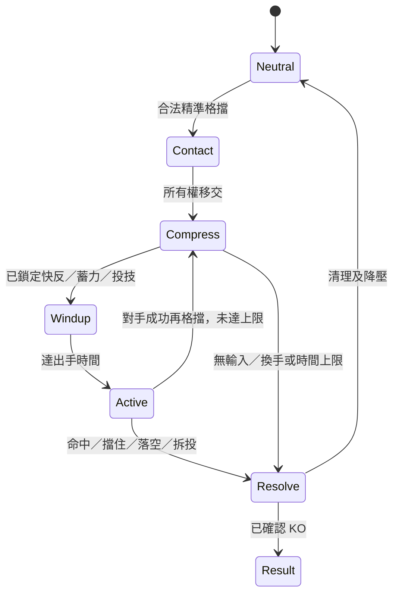

# 爽感、交鋒及整體演出優化計劃

最新實作進度：使用者其後授權開發，本輪已落地 P1a 專用練習及部分 P2 視聽、短 KO；見 [KINETIC_OVERDRIVE.md](KINETIC_OVERDRIVE.md)。下方仍是完整計劃及起始參數，P1b、選角／VS 等未完成；已實作細節以新交付文件為準。

日期：2026-11-09。對照版本：`abf0dfc`，Godot 4.6.3 Compatibility。**本文件是下一輪規格與實驗計劃，並非已實作或已驗收功能。**

## 1. 結論與來源界線

建議以「近身借勢 → 完美格擋換手 → 蓄力改拍 → 反擊釋放」作為下一個小原型。角色直接打鬥，累積的是交鋒張力，不加入球。先讓兩個人之間的一次接觸有重量，再擴充選角、過場和終結演出。

已完整閱讀並保存兩份使用者文字：[來源及雜湊](../references/feel-2026-11-09/README.md)。第二份描述 [YouTube 對戰影片](https://www.youtube.com/watch?v=4GLOxEmgoEI) 的時間碼、色盤與鏡頭；本輪沒有獨立觀看或逐幀量測影片。因此「FOV 70–80」「特定球速觸發變色」「某段恰好兩幀」等只列為來源的觀察，不能稱為官方規則或已驗證事實。LLB 的貼身搶球也不能直接當作角色完美格擋的證據。

文件內的 Master Prompt、範例程式和實作要求是參考素材。本輪使用者要求是吸收、記錄及詳細計劃，沒有直接執行其中的程式。以下數值均為本遊戲的**起始調校值**，不是複製原遊戲的量測結果。

已確認的長期目標：近身格鬥、JSR/BRC 色塊與硬邊、港式街角、斑馬線前景可讀、強烈打擊感、清楚 UI、保留無文字招牌。新「格擋連鎖」尚是推薦實驗，**目前已接受及實作的三階壓力／三選對峙仍是基線**，見 [PRESSURE_EXCHANGE.md](PRESSURE_EXCHANGE.md)。

## 2. 先補甚麼，為甚麼

爽感循環應是：**讀得懂的預備 → 接觸定住 → 能量向內壓縮 → 突然向外釋放 → 看得懂的受擊／換手。** 每一拍都大爆炸會失去對比；高強度演出應由玩家真正完成的交鋒觸發。

| 現況（已存在） | 仍缺少的體驗 | 下一步 |
|---|---|---|
| 六種攻擊弧、投技弧、頓幀保持及釋放反衝 | 普通命中與高張力換手差異還不夠明顯 | 把接觸、壓縮、釋放設為不同事件，按級別升級 |
| 6 tick 精準防禦、90 tick 冷卻 | 不能雙方連續反格擋；AI 目前停用精準防禦 | 獨立的連鎖模式與公平 AI，保留一般格擋冷卻 |
| 0–90 共用壓力、高壓 K 觸發 24 tick 三選 | 頓幀主要是選項，尚無持鍵蓄力的節奏變化 | 練習內比較舊對峙與新連鎖，兩者互斥 |
| 14 段 CC0 動作加拳腳／投技修正 | 角色缺少蓄力、極端反衝、勝利等識別姿態 | 先補一套完整的接觸到收招動作鏈 |
| 同一角色模型的兩種配色 | 沒有真正多角色、選角、VS 轉場 | 先資料化角色，再展示真實可玩選項 |
| 即時街景標題、雙語原生選單 | 缺少由選角一路到結果的演出連貫性 | 最後接成可跳過、可重賽的流程 |

不應靠增加畫面閃爍來掩蓋角色朝向、接觸距離或腳滑。每次改演出都保留「關效果」比較，確定判定本身成立。

## 3. 戰鬥原型：有限換手，逐級加壓

### 3.1 與現有系統的關係

新增開發／練習設定 `exchange_mode = legacy_pressure | parry_rally`，預設保留現行模式。第一版新模式只在練習提供，不同時開啟三選對峙。通過可讀性、公平性與真人 A/B 驗收後，才決定是否替換正式模式。

沿用原本的能量及共用壓力。連鎖期間，壓力條暫時顯示「主動方＋第幾次換手」，結束後回到普通壓力；不再加第三條永久資源。能量核心只是拳腳接觸的視覺符號，沒有可飛行、碰撞、反彈的球。

### 3.2 一次交鋒怎樣玩

1. A 的地面近身攻擊被 B 新按下的精準格擋接住。B 取得主動，兩人的姿態短暫鎖在接觸點。
2. B 在停頓中選擇快反、蓄力反擊或近身投技。防守方看蓄力動作、聲音及接觸點，預判出手時機。
3. 釋放時進入真正的起手與有效幀。A 可以再次精準格擋換手，也可以普通防禦、閃避、跳開或拆投；距離及空中狀態仍有意義。
4. 成功再格擋使張力升一級；失敗則依實際命中結算傷害、擊退或投技，回到普通戰鬥。
5. 設換手上限與時間上限，避免雙方永遠鎖在演出中。滿血角色不會因第一次失誤就必死。

### 3.3 起始數值（60Hz，待試玩調整）

| 換手等級 | 接觸壓縮時間 | 下一次精準格擋有效窗 | 快反命中傷害 | 視聽識別 |
|---|---:|---:|---:|---|
| 1 | 12 tick／0.20 秒 | 6 tick | 12 | 小型接觸環、單一重音 |
| 2 | 16 tick／0.27 秒 | 5 tick | 16 | 內收碎片、短殘影 |
| 3 | 22 tick／0.37 秒 | 4 tick | 21 | 較深背景、低頻蓄力 |
| 4 | 30 tick／0.50 秒 | 3 tick | 27 | 短暫雙色場景、較大釋放弧 |

傷害基於現有 100 HP、重擊 18／能量技 27 的量級起步；蓄力最多加 3，單次上限 30。**演出可以極端，傷害及角色速度不能每拍翻倍。** 不使用虛假的「×8 傷害」標籤；直接顯示等級。

初次格擋後有四次反擊換手機會；計入初次格擋，**第五次成功精準格擋**讓能量安全散去、雙方回中立，不強制某方中招。整段最多 300 tick／5 秒，包含壓縮、蓄力與有效交手；暫停／失焦才暫停此計時。回合倒數在連鎖中停住，不能被無限延長。

### 3.4 操作與反制

| 主動方指令 | 起始規格 | 防守方可做的事 |
|---|---|---|
| J 快反 | 壓縮結束後至少 10 tick 可見起手；不採用無提示一幀命中 | 準時新按 Shift、普通防禦；提前閃避／跳開可能被快反抓到起動 |
| K 蓄力反擊 | 新按 K 鎖定分支，持住／放開決定壓縮後額外 6–18 tick 延遲，達上限自動出手 | 觀察姿勢及聲音，改格擋時機；後退／跳開可使攻擊落空 |
| G 能量投技 | 連鎖情境支付 25 能量；距離、地面條件及拆投窗口仍生效 | G 拆投、跳開、閃避；不能被普通防禦擋住 |
| 沒有輸入 | 到選擇截止安全散能，不自動打出攻擊 | 回中立，不作免費命中 |

一般戰鬥 G 投技維持原本的免費／12 傷害規則。新模式的 E 連鎖脫離暫定花 20 能量，與普通 E 免費衝刺分開提示；現有場邊受身也花 20。這些是情境設計，須實測是否過於複雜，不能悄悄改所有 E 的成本。

首個合法分支輸入鎖定；選擇截止為該級壓縮結束。J／G 在壓縮結束才進起手；K 放開只控制已選的蓄力，提早放開記為最短額外 6 tick，之後放開則取當時延遲，上限 18 tick。能量不足的 G 不扣款、不鎖死選擇，保留餘下選擇時間並短提示。攻擊在釋放時重新檢查距離、朝向、空中與無敵，不能把落空自動修正成必定打中。

防守方的普通防禦、跳躍及 E 在規則允許時立即接受；釋放後最多 6 tick 接觸反衝再恢復步行。第一版防守方不在連鎖內排普通攻擊長佇列，因此不把快反宣稱為「剋偷攻」。先證明格擋／退避／拆投成立，再考慮反擊分支。

### 3.5 避免連按必勝與單方面處刑

- 精準格擋必須是**新的 Shift 按下邊緣**。預先按住只算普通防禦；停頓期間按住不能自動在每拍重新觸發。新連鎖的精準窗口只在釋放後的實際起手／有效交手階段接受，不從壓縮期排入免費格擋；普通防禦可保持。
- 連鎖內換手後才重新允許下一次精準格擋；失敗窗口耗盡後暫定 10 tick 禁止重新試探，連按不延長有效窗。一般戰鬥保留 90 tick 冷卻。
- 普通防禦承受有上限的防禦值損耗；不因高等級就全血強制死亡。取消永久防禦、永動能量及無限連段的途徑，但給玩家讀得懂的退出方法。
- 既有 AI `allow_parry:false`，必須新增同規則的反應延遲、失誤與出招承諾。AI 不可看到玩家本 tick 選擇後改答案；練習提供可信預告，正式難度不提供完美讀心。
- 第一版不加瞬移背後或上下猜防。現有自動朝向與非方向防禦尚不足以支撐這些博弈。

## 4. 視覺、動作和音效：每一拍有不同工作

| 階段 | 角色／VFX | 音效 | 鏡頭 |
|---|---|---|---|
| 預備 | 重心下沉、肩髖扭轉，拳腳輪廓可讀 | 短促衣物／腳步 | 維持雙人構圖 |
| 接觸 | 身體擠壓、接觸十字、短局部反白 | 清脆起音＋身體重音 | 單次有方向的小反衝 |
| 壓縮 | 核心向內收、碎片倒吸、視覺模型微抖 | 逐級升音，最高約 1.3 倍音高 | 輕微收近，仍見雙方 |
| 釋放 | 1–3 張 smear、月牙弧、短殘影 | 爆發重音＋低頻；出手前短空隙 | 隨打擊方向退讓後回穩 |
| 後果 | 受擊折身、腳步回穩、擊退／換手色變 | 落地與場邊接觸聲 | 保持落點、不要急切鏡 |

### 4.1 VFX 與色盤規範

普通攻擊弧目標不超過畫面高度約 18%，高級交鋒約 30%；來源提到的 70% 巨弧只考慮已確認 KO 後的演出。特效不能遮住兩個人的腳底、接觸點和下一次出手預備。

接觸環以玩家顏色＋不同形狀／方向標示主動方，不單靠紅藍辨識。普通命中不全屏閃；第 4 級或勝負確認才使用少量強烈剪影。高壓可用「正常 → 暗背景＋角色亮色 → 明亮雙色」三級色盤；亮背景自動換深色攻擊弧。色盤保持一小段穩定時間，不快速紅白交替，不在高速連按時重複閃爍。

F2 減少演出：關閉全屏閃、抖動、強烈動態縮放及鏡震，保留靜態接觸環、主動方箭頭、充能進度和聲音識別。選角／VS／KO 也遵循相同設定。

視覺微抖起點約 0.015–0.03m，上限 0.05m，只改模型子節點，不改判定／碰撞。亂數種子與戰鬥邏輯分開。效果維持現有 64 上限與有界釋放佇列，超額優先回收遠小碎片；接觸核心最多一個，換手時轉移所有權，不清掉全場其他合法效果。

「兩幀閃光」用展示時鐘設約 33ms 有效期，不強制低 FPS 也顯示足兩個渲染幀；掉幀可以略過閃光，不能拉長到數百毫秒。正式強度以實際螢幕試玩調整。

### 4.2 動作與 Blender 銜接

優先補：蓄力保持、快反釋放、重反釋放、極端受擊／回穩、入場／挑釁、勝利姿勢。先做好同一角色的一整套，再擴充第二角色。

目前提取器只取旋轉與髖部位移，雖保存 interpolation 欄位，執行期 quaternion 採 slerp；**Blender Constant 曲線不會因此自動變成遊戲抽幀**。骨骼 scale 與 shape key 也沒有完整接入。第一輪可用外掛 smear 網格及明確的姿態保持；後續才擴充 STEP／LINEAR 取樣、縮放與形態鍵，連同重定向、rest pose 及混合測試。

關鍵姿態應標記預備、接觸、釋放、回穩時間；腳底不滑、出拳接觸點對準、關閉未設計的 root motion。誇張拉伸只動視覺骨架，碰撞仍由模擬決定。臉部可局部整理法線，不能把整個身體球形平滑而失去硬邊風格。來源 GLB 保留，衍生版本獨立記錄。

### 4.3 音樂與音效

現有 CC0 音樂與 Kenney 音效繼續作基線。重擊先調「起音、身體、低頻」三層的時間與頻率，不單純加音量；每次接觸最多三層，沿用有上限的聲道池。爆發前約 20–40ms 短空隙與音樂降低 3–6dB／80–160ms 可先比較，不能讓每次輕拳都把音樂抽空。

升級聲要能分辨第 1–4 級，低能量則不同提示；左右定位服從角色位置，連按有去重／最小間隔。不要要求玩家配合 BGM 節拍才可格擋。

較有街頭 Funk／Breakbeat 質感的配樂列為後續素材工作：逐件確認作者、授權、下載來源、改作／散布條件及音量；不能從 LLB 影片抽取音樂、角色語音或撞擊聲。

## 5. 鏡頭、場景和終結演出

### 5.1 戰鬥鏡頭

維持現有單一鏡頭控制器，優先序「勝負演出 > 轉場 > 接觸反衝 > 追蹤」。不要再用另一個腳本同時寫 FOV／位置。正常基準 FOV 48，交鋒起點限制約 44–52，瞬間變化先控制 2–3 度；距離／偏航仍以雙方不出框、斑馬線水平和街道比例合理為準。

彈簧採解析／穩定阻尼或受限子步進，不能在任意 delta 直接跑高剛性 Euler。測試 30／60／120 FPS 與偶發長幀，鏡頭不發散。F2 使用平順追蹤；不得因減少演出失去基本對手可見性。

場景仍保留飛機正向、原圖片天空／慢雲、兩側街角和車輛。高壓變色只暫時調色，不替換天空貼圖、不拉長建築、不拿大片弧掩蓋透視問題。招牌維持留白。

### 5.2 KO 與結果

先由模擬確認 HP、回合勝者及場數，再播放展示。普通回合 KO 先試 0.25–0.45 秒，整場終結 0.6–0.9 秒；讓強演出稀有。只在真正結束時才可用較誇張的 60–70 度視角、受擊者剪影、放射背景及勝者前景。

受擊者的鋸齒飛行／兩次視覺反彈只作用於展示替身，不再計傷害，不真的破壞街景建築。沒有已驗證的臉部 shape key 就不承諾臉部扭曲演出。

實作前保存原鏡頭 transform／FOV／cull mask／環境，明確分配展示層。不能直接假設 mask=2 就只剩角色；天空 Environment 也不由一般物件遮罩控制。放射背景應在鏡頭前方的平面或 2D／SubViewport 底層，字面上的「放在攝影機後面」不會被看見。

結果頁：勝者姿態左側、勝負／場數／清楚的重賽與回選角右側，延用原生字體與焦點。Enter／Space 可跳過過場但不把該次按鍵帶成下一回合攻擊。跳過、重賽、回標題、F6、失焦或場景卸載都要清理色盤、反白、慢速、鏡頭與待播放音效；維持已修好的逐回合時鐘與反白退去。

## 6. 選角、VS 和完整流程

目標流程：標題 → 選角 → VS／載入 → 短入場 → 對戰 → KO → 結果 → 快速重賽或回選角。

### 6.1 先有真角色資料，再做選角畫面

第一版展示現有角色與配色。只有模型、動作及招式差異真的接妥，才標為第二個可玩角色；不做假裝四名角色可選的介面，也不先做商店與解鎖經濟。

角色資料至少含 id、模型／預覽場景、頭像、配色、動作組、招式表、風格說明、可玩狀態及素材授權。未來「快拳型／重擊型」可從起手、距離與恢復時間區分，先共用 100 HP，避免換皮加假能力值。

### 6.2 選角視覺與互動

取現有街角的一小段作車庫式預覽，不重建大型地下場景。使用剪切色塊、斜向裝飾、角色大剪影及少量紋理；保留繁中／英文可讀字體。斜 12–18 度只施於裝飾，按鈕命中框、字體與焦點仍清楚，避免「看得到卻點不到」。

懸停回應約 80–140ms，確認約 180–240ms：姿勢切換、色塊蓋印與低頻聲，預設不全屏閃。支援鍵盤、滑鼠、返回、焦點恢復及減少演出。最多保留兩個預覽模型，移動焦點不反覆載入完整街區。

### 6.3 過場和載入

VS 用原創角色剪影／頭像與斜向色塊擦拭，明確顯示兩方。第一次入場約 1.2 秒，重複約 0.35 秒或直接快速重賽；能跳過。切場景時有真實載入狀態，失敗可重試／返回。

`ResourceLoader.load_threaded_request` 只處理資源讀取，不保證 `.instantiate()`、大量節點 `_ready()` 或 shader 首幀無卡頓。需要量測冷啟動與暖啟動，預載／重用街景，必要時在過場遮罩後預熱兩幀；用 generation token 讓取消後的載入結果不覆蓋目前畫面。不能用假進度百分比或「無黑畫面」口號代替驗證。

## 7. 技術契約：讓演出不破壞規則

建議新增純資料 `kinetic_rally.gd extends RefCounted`，由現有 `fight_simulation.gd` 單一呼叫；不要另放一個 Autoload 自行凍結所有角色。

- 邏輯一律 60Hz；壓縮由 rally 自己計 tick，這時不再累加一般 hitstop。主動方、輸入鎖定、分支、級別、傷害、取消原因都能記錄及重播。
- 每 tick 先收雙方指令再做一致的接觸判定，雙方位置互換不偏袒 P1。回合已結束則拒絕新交鋒；KO／逾時與同幀接觸的先後必須有測試。
- 第一版只接受地面、正面、單一合法接觸，不在空中／受擊／既有投技中觸發。初次普通攻擊被格擋後，不另扣一次普通命中傷害；現金結算只一次。
- 初次精準格擋沿用能量 +12／壓力 +16 一次，後續換手不重複刷能量。連鎖期間停一般壓力增長，結束統一降壓與冷卻。
- `fight_session` 現在忽略 key-up。蓄力必須新增按下／持住／放開狀態及失焦清除，不能只在現有 pressed handler 加一個 if。
- 展示事件包含 `round_generation`、事件 id、owner、tier、接觸點、分支／預備時間、結果；同事件不可重複播音或扣血。跳過過場或重開後舊事件失效。
- 戰鬥凍結時展示時鐘繼續，真正暫停時兩者都停。粒子／音效釋放、結果動畫及鏡頭不依賴凍結中的角色倒數。
- 高壓材質作用範圍只在本場／預覽，退出即恢復。來源 shader 的 `unshaded` 加未使用 `shadow_tint` 不等於階梯賽璐璐；需要明確光照 ramp 或沿用已驗證風格材質。

## 8. 開發次序與每階段交付

| 階段 | 交付範圍 | 通過才繼續的條件 |
|---|---|---|
| P0 基線 | 固定輸入的普通拳、重擊、精準格擋、投技、KO 片段與事件紀錄；現有模式可隨時回切 | 所有基線能重現；先排除朝向、接觸點與腳滑 |
| P1a 最小連鎖 | 練習限定、新按 Shift、只做快反、1–4 級及上限、簡單接觸環 | 雙方都能換手；沒有重複傷害、永凍或按住自動格擋 |
| P1b 真博弈 | 加持放 K、G／拆投、E 成本、落空／跳躍、AI；教室慢步演示 | 每分支有可驗證反制；AI 不讀心；舊／新模式互斥 |
| P2 重量與爆發 | 一個角色完整預備／壓縮／釋放／回穩，分層音效、smear、色盤及 F2 | 關閉大效果仍讀得懂；兩人與接觸點可見；真人 A/B 通過 |
| P3 選角與風格 | 真角色資料、配色、預覽、雙語原生選角、鍵鼠／返回 | 不展示假可玩角色；反覆切換不重載整場或漏資源 |
| P4 過場與終結 | VS、可跳入場、真 KO 演出、結果與快速重賽 | 無重複結算；鏡頭／色盤／輸入每次完整還原 |
| P5 整合調校 | 目標硬體效能、冷暖啟動、長時遊玩、音量與減少演出 | 有可重現報告，明確區分雲端、真人及使用者電腦結果 |

P1a 是下一個實作起點，不先做整套華麗選角。先以同一角色的兩方完成核心，再決定是否值得增加模型製作量。各階段以驗收條件推進，不能把工作時數當成好玩的證明。

## 9. 驗收矩陣

### 規則與輸入

- 兩份獨立 simulation 以同種子執行至少 25,000 tick 混合指令，比較每 tick 結果；這是未來目標，本輪未跑此新系統。
- 逐級測成功／過早／過晚格擋、按住／連按、同幀輸入、無輸入、能量不足、落空、邊界、空中、普通防禦、拆投及第 5 次成功格擋散能。
- 確認 12／16／22／30 tick 停頓、6／5／4／3 tick 格擋窗、5 秒上限；連鎖只有一次傷害或一次換手結果，能量不負數、壓力不重複增長。
- 暫停、失焦、放開 K、重設、跳過、回標題、F6 後，沒有卡住的持鍵、延遲攻擊、殘留色盤或錯誤相機。

### 畫面、效能與流程

在 960×540、1280×720、1920×1080 及 4:3 檢查焦點、文字、雙方入框與特效遮擋。正常／減少演出、兩種主動方、各級快反／蓄力、回合 KO／整場勝負都要留證據。

記錄同場景同硬體的 CPU／GPU frame time、p95／p99、draw calls、效果數、聲道、載入及記憶體。目標 60FPS 對應 16.7ms，但必須指定硬體；雲端軟體渲染數字不能當玩家 GPU 效能。截圖／錄影開銷與正式量測分開。完成新改動後才跑對應回歸，不挪用舊版 374 等檢查數量宣稱新系統通過。

### 真人試玩（才回答好不好玩）

邀 6–8 人各玩約 5 分鐘，舊／新模式隨機次序，記錄主動方辨識、快反／蓄力差別、失誤原因和最想重玩的瞬間。第一批可用「6 人至少 5 人在第二回合能指出主動方與兩種節奏差異」作可讀性門檻；分數與勝率只作調校依據，不宣稱小樣本證明平衡。

理想常見交鋒約 2–4 次換手、整段不超過 5 秒；太常首拍死亡、一直普通防禦、固定 J 壓制 AI、或玩家不知道為何中招，都應回調窗口／距離／提示。把「重量感、控制感、可讀性、想再玩」分開詢問；效果更大不等於更好玩。

## 10. 素材清單及是否需要 Tripo

第一、二階段可用現有角色、程序網格與原創向量素材，**暫時不需要使用者再生成 Tripo 模型**。

| 素材 | 起始規格 | 使用限制 |
|---|---|---|
| 撞擊／壓縮遮罩 | 512px，透明底，約 6 幀，硬邊黑白形狀 | 不含字、不預烘彩色光暈，執行期染色 |
| 月牙與 smear | 少面數平面／錐形網格，1–3 姿態 | 跟隨攻擊方向，不遮角色整身 |
| 放射背景／擦拭 | 雙色高對比，可縮放向量或遮罩 | KO／VS 使用；F2 靜態替代 |
| 角色肖像 | 從自己的角色渲染，統一角度／光線 | 與實際模型、配色相符 |
| 蓄力／反衝／勝利動作 | 先做一套，接觸幀標記、足底穩定 | 保留來源、授權、衍生流程 |

未來真需要第二個角色時，再交付正／側／背參考圖、比例、骨架／綁定要求及美術規格，讓使用者在 Tripo 生成。目標風格可參考 1,500–3,500 tris、256／512 貼圖、輪廓優先，原始生成結果保留、遊戲版另做可追溯簡化。不抄 LLB 角色、標誌、音樂或畫面貼圖。

## 11. 可交給下一位 AI 的實作摘要

> 先讀 AGENTS、HANDOFF、本文件、PRESSURE_EXCHANGE、IMPACT_STAGING、EXTENDED_POLISH，檢查實際 HEAD 與未提交內容。實作 P0／P1a：只在練習增加互斥 parry_rally 模式，正式仍用既有壓力三選。純 60Hz RefCounted 規則、雙方新按 Shift 格擋、快反 1–4 級、第五次成功格擋散能與 5 秒上限。不要新增球，不把輸入直接綁在展示動畫，不用 Autoload 反覆 pause／unpause 角色，不讓普通 hitstop 和連鎖停頓相加。先做簡單接觸環與事件紀錄，證明兩方都能換手和結束；蓄力／投技／華麗 UI 待後續階段。補真正驗證結果並記下未驗收項。只提交／推送開發分支供 GitHub Desktop 拉取；除非使用者另行點名，不改公開 Web，不聲稱已同步使用者電腦。
