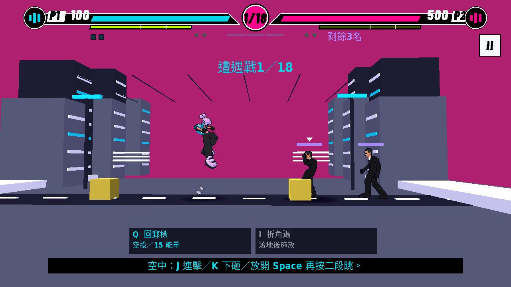
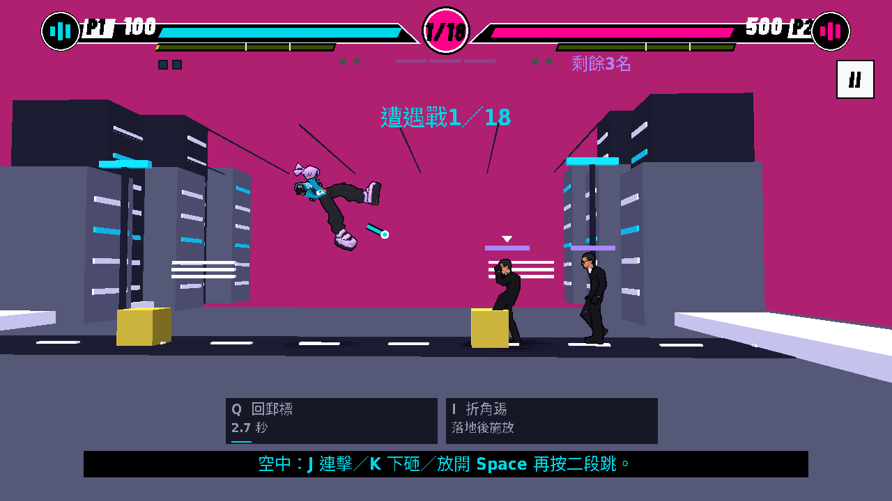
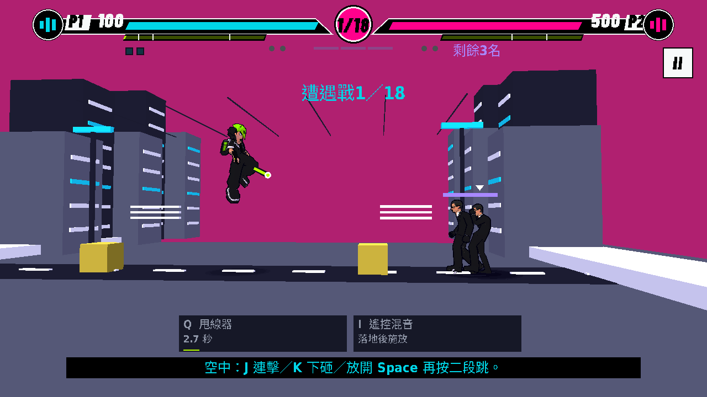
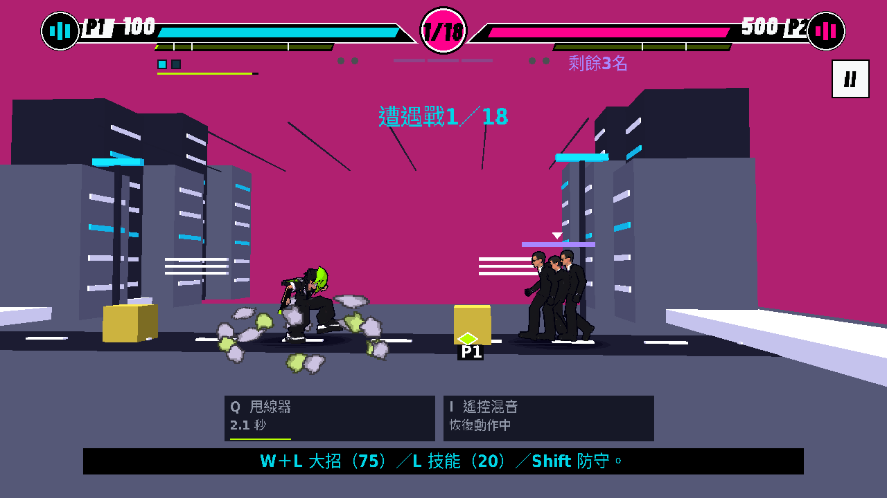

# Aerial support evidence — 2026-11-16

[Behavior, controls and limits](../../TACTICAL_AIRDROP.zh-TW.md).

- [59 focused rules](rules.json): all24 compatibility cases, real downward paths/contact/mark/node, shared fast-fall and diving budget, no refreshed double-jump/chase/stall budget, ordinary ground behavior, eight actual extra recovery ticks, queued jump/attack, interruption instead of late double punishment, disabled-mode isolation, freeze, schema6–7 byte preservation/preset reload and malformed schema6 rejection.
- [17 native checks](native.json): real module picker, actual save/load buttons, actual Space jump then Q, legal aerial fee hint, paid descending projectile, landing commitment, real ZIP mark / one LOOP node and exit cleanup. Test account best18,100 energy, relocated500-HP static enemies, AI disabled for observation. These are controlled fixtures, not natural battle or human balance evidence.
- [Regression matrix](regressions.json): modules83, expanded111, original106, readiness53, enemy-response42, service46, city86, campaign50 and gun21; added schema7 coverage explains the increased migration counts. [Chinese glyph coverage](chinese.json) remains complete.
- Native regressions: [modules8](verify_tactical_modules_native.log), [expanded39](verify_expanded_native.log), [enemy-response8](verify_enemy_response_native.log), [readiness14](verify_tactic_readiness_native.log). Current snapshots: [modules](module-native.json), [expanded](expanded-native.json), [response](response-native.json), [readiness](readiness-native.json), [module rules](module-rules.json), [expanded rules](expanded-rules.json), [first-eight rules](first-eight-rules.json). Historical evidence folders are restored before commit.
- Standard-mode regressions: [Rush22](rush.json), live combat45 and squad35. The historical Rush immediate-throw-damage assertion fails identically at isolated9b13331 ([baseline context](baseline/context.json), [expected-failure log](baseline/rush.log)); current runner verifies actual pair interruption, no early damage, and exactly one12-damage landing. Throw runtime is unchanged.
- [22 scripts under seven fatal warning categories](changed-strict.log). Accepted engine/script logs have no errors; Xvfb V-Sync warning remains.

Environment: Godot4.6.3, Linux Compatibility/Mesa llvmpipe,1280×720, Dummy audio. Not Mac, real controller, speaker listening, human ergonomics or hardware FPS validation. Original GLBs/BGM, Latin pixel fonts and5/8/100 preset are unchanged; catalog additions retain regenerated Chinese coverage.







After importing assets, from repository root:

```sh
python tools/verify_tactical_compile.py --output docs/evidence/airdrop-module/changed-strict.log
godot --headless --path godot --script res://tools/verify_airdrop_module.gd
# Requires an available X display or desktop:
godot --path godot --rendering-method gl_compatibility --audio-driver Dummy --script res://tools/verify_airdrop_native.gd
```
