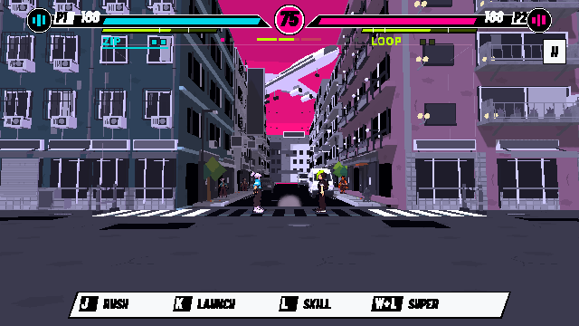
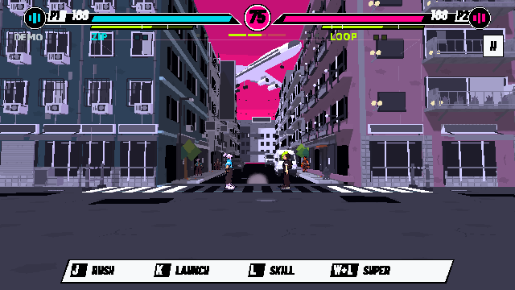

# 戰鬥HUD簡化與來源同步

2026-11-11，基於main679b42b。上一輪僅提出建議；使用者要求推送全部更新後，本輪把建議落實為runtime，再同步main。公開Web不更新。

## 改動

- 血量／能量／時間保持，加兩個勝場小點；不改simulation、費用、招式及場景。
- 刪除戰鬥中的NEON FACETS LAB開發標籤。
- 角色顯示短名字，ROUTE／PRELOAD／NODES改兩格，SAMPLE一格；空格仍可辨，保留真實期限細條、LOOP地面節點及群戰剩餘數量。
- SURGE改三段細色條，移除常駐數字／兩行大黑框；只有升階時短暫顯示HEAT／SURGE。教學仍能讀精確值，正式對戰不再顯示內部continuation LOCK字卡。
- DEMO改小標籤；回合資訊沿開場、勝場點及結果呈現。PAUSE改右上II，保留tooltip、滑鼠及Esc。
- 二段跳保留即時弧光／動作／音效，完全不再產生DOUBLE JUMP字卡。正式模式隱藏追擊成功、資源增加、普通block、反彈等例行文字，保留重要格擋／破防／反擊、追擊不可用等判斷提示，及人物旁的受身／反擊機會。
- 能量不足直接在對應能量條短暫顯色；暫停凍結、重開清除，不改或中斷音樂。練習／教學保留原完整說明。

## 最終驗證

以 `accepted/summary.json` 為本輪通過的最終集合：78/78，對應四份原始JSON／log同目錄。

- compact HUD 21：文字政策、教學說明、二段跳局部回饋、自己的資源警告／暫停與清除、實際滑鼠點按縮小後Pause、真狀態不被HUD修改。
- 二段跳原生12：用正常Enter先跳過現行開場，再以Space驗證起跳／第二跳／OS echo／暫停／F2／重開。回歸條件由舊字卡改為立即局部弧光，保留實際跳躍條件。
- 原生UI／音樂37：原選單、角色頁、Pause及持續BGM等。
- 八檔startup warning-as-error編譯：通過。

所有accepted log沒有ERROR／SCRIPT ERROR。Godot4.7.2 Linux Compatibility／llvmpipe／Dummy audio，VSync不支援警告保留；不是使用者Mac、人手閱讀／手感或硬件實聽驗收。

`initial-attempts`保留初次失敗及中途輸出：跨script直接給typed Array賦untyped literal造成清理錯誤，已改原陣列fill；舊二段跳fixture第一下Space被最新開場正常消費，已加真Enter跳過並增加檢查；快速建立intro後立即退出的test在audio mixer尚未處理stop時退出，verbose定位intro.wav／OGG playback後，只在測試teardown停audio並等待mixer消費，沒有改runtime音樂transport規則。不要把中途檢查數或退出錯誤當成最終通過。

重跑：`python tools/verify_game_polish.py --godot /path/to/godot --mode native --only verify_compact_hud,verify_double_jump_input,verify_reference_ui`，需有效DISPLAY／XAUTHORITY。截圖為真native renderer，歷史double-jump／ui-replica圖片已還原；本輪圖片集中於此。
