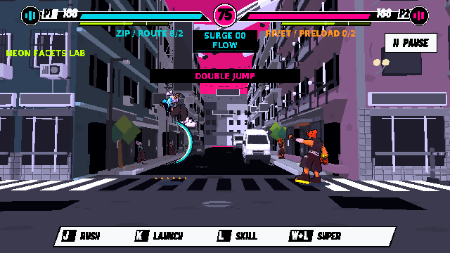
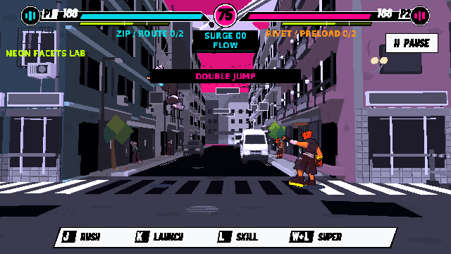
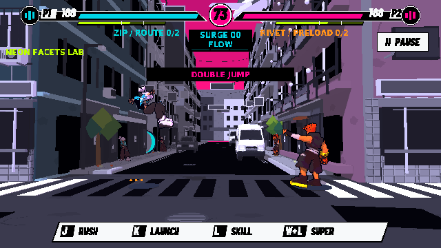

# 二段跳驗證

基線 f53c378；Godot 4.6.3 Linux Compatibility／Mesa llvmpipe／Dummy audio。不是真人手感、目標 GPU 效能或實聽驗收。

- `rules.json`：62/62，四角色／雙方、單次空中跳、落地預輸入與 6,000 tick 重播。
- `native/verify_double_jump_input.log`：11/11，正式 FIGHT 注入 Space 放開再按、OS echo、暫停、F2、回充、鏡頭及清理。對應 report 在 native/reports/double-jump/input.json。
- `headless/summary.json`：201/201，charged_cannon、rush_arcade、friendly_defense、air_counter、aerial_street、combat。
- `additional/summary.json`：二段跳 62/62、鏡頭 13/13；舊 combat_polish 34/35。
- `native/summary.json`：二段跳 11/11、reference_ui 37/37；舊 cannon_input 5/7、aerial_input 30/31。
- `live-combat.json`／`live-combat.log`：45/45，現行正式戰鬥與 12,000 tick 重播。
- `baseline-headless/`、`baseline-native/`：未改動的 f53c378 隔離 worktree，三套舊測試同樣 34/35、5/7、30/31。失敗來自舊 transport／角色縮放／重砲演出預期，並非這輪新增回歸。沒有刪除或改低門檻。
- `failed-display/`：首次 native 執行缺 Xauthority，未跑到 assertions；使用已啟動共享桌面的 X11 授權檔後正常渲染。CUA 首次初始化回報 sandbox 錯誤，後續以 Godot 原生 renderer 驗證。
- `import.log`：首次完整匯入，沒有 ERROR／SCRIPT ERROR。匯入產生的來源 .import 差異及無關 UID 已還原，原模型與字體來源不變。

其餘本輪通過的正式／新增 suites 沒有 ERROR／SCRIPT ERROR。native VSync 不支援警告保留；舊失敗 suites 的錯誤與 ObjectDB 清理警告留在 log。所有 report 及 screenshots 為本輪產生，既有證據已還原。

重跑：先 `godot --headless --editor --path godot --import --quit`，再 `python tools/verify_game_polish.py --mode headless --only verify_double_jump`；原生模式需有效 DISPLAY／XAUTHORITY，使用 `--mode native --only verify_double_jump_input`。runner 會保留歷史 report，並將 engine ERROR 視為失敗。
