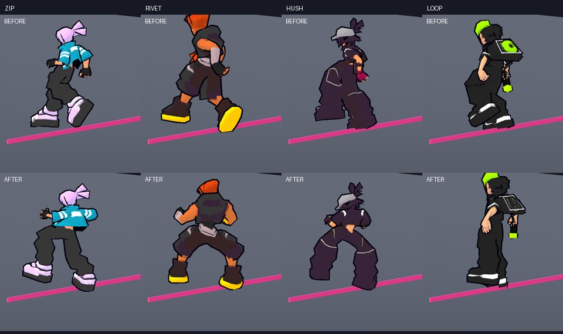

# Ground locomotion review — 2026-11-16

[Findings and limits](../../GROUND_MOTION_REVIEW.zh-TW.md).

- [21 focused rules](rules.json): observed speed, clipped movement, pushed/reversed displacement, F2, physics purity, interpolation fraction, frozen gait, authored dash/attack/air behavior, teleports, role changes and four actual wall-command runs.
- [Comparison](comparison.json): matched authoritative motion traces;324 stationary-but-commanded samples selected walking/running before,0 after,0 with F2.
- [Before audit](before/audit.json), [after audit](after/audit.json), [F2 audit](reduced/audit.json): four real hero rigs × seven controlled cases,33 checks each. Positions are explicit setup fixtures; subsequent motion uses ordinary semantic commands, not injected velocity.
- [Regression matrix](regressions.json): continuous79, Transit216, Street90; [1800tick dual-path gameplay report](gameplay.json) records0 simulation mismatches and0 presentation mutations. [23 scripts / seven fatal warning categories](changed-strict.log).
- [SHA256 roster](hashes.json) covers evidence files, not a game-dev sealed bundle. The project has no adapter/CLI; no packaged adapter was installed. Color and rig/command telemetry only, no semantic render attachments or hardware-performance claim.



[Before six-second clip](before.mp4) / [after six-second clip](after.mp4), each180 frames at30fps, same neutral diagnostic floor/camera/light and original rigs. [Before capture trace](capture-before.json) / [after capture trace](capture-after.json). Before retains eight matched blocked-motion street snapshots; after/reduced also retain intermediate stop/reversal/dash review snapshots. Nonblocked stills are not paired raster comparisons. All authoritative trace samples are matched. These use diagnostic framing, not a changed gameplay camera.

Environment: Godot4.6.3 Compatibility/Mesa llvmpipe,1280×720, Dummy audio. Baseline5ba39a4 was also checked out separately for the short clip with the exact same capture script and imported assets. Nonfatal V-Sync warning and baseline-audit shutdown ObjectDB warning are retained; no accepted engine/script errors. Not human timing, Mac, controller or hardware FPS certification.

```sh
python tools/verify_tactical_compile.py --output docs/evidence/ground-motion-review/changed-strict.log
godot --headless --path godot --script res://tools/verify_observed_locomotion.gd
# Requires a desktop or X display:
godot --path godot --rendering-method gl_compatibility --audio-driver Dummy --script res://tools/audit_ground_motion.gd -- res://../docs/evidence/ground-motion-review/after/
godot --path godot --rendering-method gl_compatibility --audio-driver Dummy --script res://tools/audit_ground_motion.gd -- res://../docs/evidence/ground-motion-review/reduced/ reduced
```
