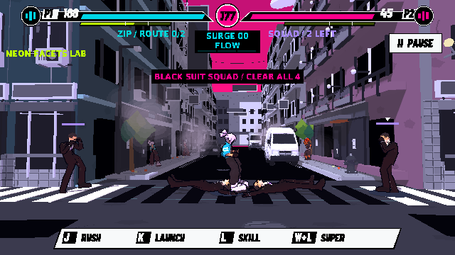

# 死亡人物貼地修正

2026-11-11，基線main7d3cab2。使用者回報死者橫躺但懸空；在五個角色上重現，原骨盆／身體仍約0.8–1.1米高。`before-probe.log`來自隔離來源副本的原始三個runtime腳本，`probe.gd.txt`保留量測方式；沒有覆寫main來源。

## 原因及修正

1. `combat_motions.gd`原本將全部clip的骨盆位移限制成-0.15／+0.12的一般站立起伏，因此Death01完整下移被截斷。死亡保留完整垂直軌跡，按骨盆高度而非上半身比例縮放，水平位移仍由simulation掌管。
2. 殘留attack／idle狀態及空中程序層會覆寫／重新起動死亡動畫。死亡用獨立穩定state key並優先選Death01，跳過活人空中／guard／招式／Neon疊加；復活重置照常。
3. 不同角色的身體／靴子／修補模型比例不同，僅還原原動畫仍可能輕微穿地。只對已落地的死者，以實際skinned頂點最低點校正到路面上0.015米；屍體停止反彈旋轉與空中伸縮。來源頂點／權重在setup快取，死亡動畫播完後快取校正值，不持續重算已靜止屍體。保留原GLB、血量、判定和正常跳躍。
4. 群戰結算時simulation凍結，原本只有當前對手套落地展示。現在非focus死者也沿result clock下降及退flash，避免最後一擊後其他屍體留在空中；不改simulation snapshot。

原先試過renderer bake來取得範圍，但尚未註冊skin／headless環境會報錯，故正式實作用來源skin bind與當前骨架CPU計算，完全不依賴GPU readback／首幀註冊。獨立native測試則等待真draw完成，以引擎bake的實際變形網格覆核，沒有用同一套計算當自己的測試答案。

## 驗證

官方Godot4.7.2.ed1daf0bf，Linux Compatibility／llvmpipe／Dummy audio；不是使用者Mac、硬件音訊或人手手感驗收。

- `verification.json`／`native.log`：104/104。五個角色×兩朝向×普通／F2；以引擎實際變形後頂點驗證最低點0.005–0.035m（目標0.015m）、死亡優先／不重播、停止反彈、狀態資料不被展示改寫、活人離地不被校正。包含仍在進行的真群戰、兩個死者及凍結result的非focus落地fixture。
- `strict/`：8/8 warning-as-error編譯，四類warning於啟動前設Error；新增三個相關runtime檔到既有檢查。
- `headless/`：33/33，四面反彈18＋結果展示15。
- `native-regressions/`：189/189，正式回合24＋CityBreaker165，保留真KO、跳過／暫停／F2及清理。
- 合共334項通過，以上最終log沒有ERROR／SCRIPT ERROR；VSync不支援警告保留。

重跑：`python tools/verify_game_polish.py --godot /path/to/godot --mode native --only verify_grounded_death`，需有效DISPLAY／XAUTHORITY。原始模型／音訊及歷史證據保持；來源main更新，公開Web未更新。
