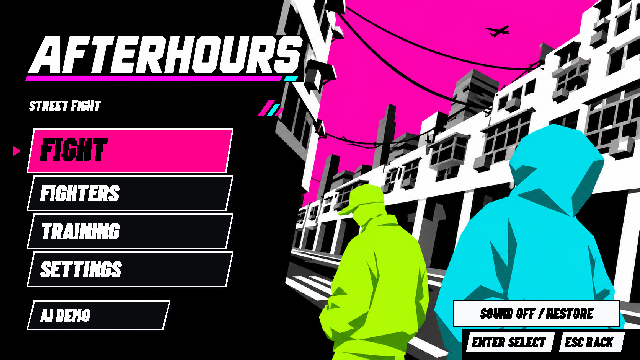
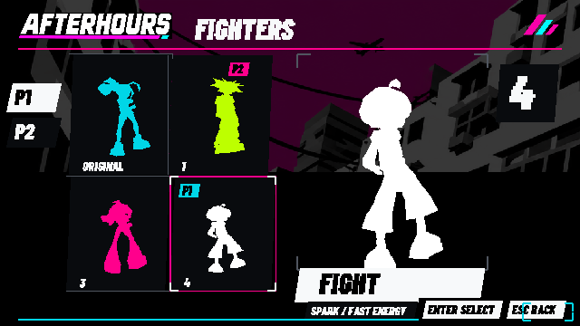
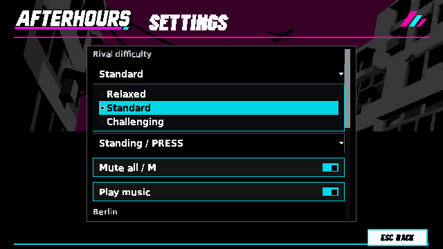
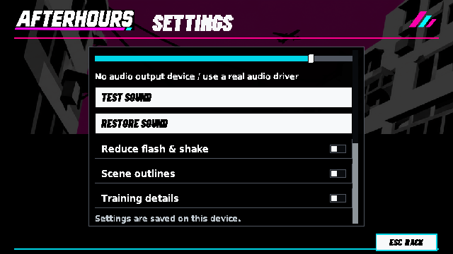
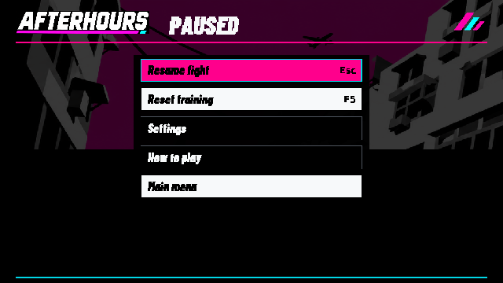
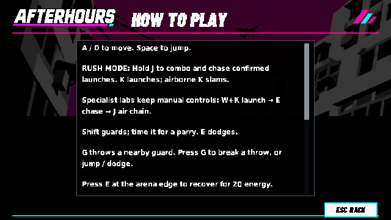
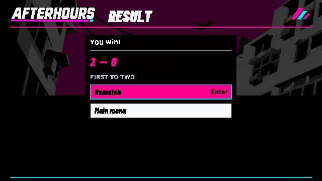
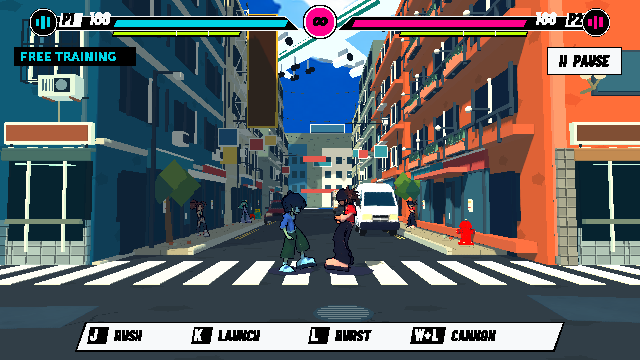

# 全套Ink UI實機

Godot4.7.2 native Compatibility／llvmpipe，640×360；沒有提高遊戲解析度。新封面無項鍊，選角為真3D剪影；遊戲角色貼圖正常。

## 主選單

## 3D選角

## 設定與原生下拉選單

## 暫停

## 教學

## 結算（狀態fixture）

## 戰鬥HUD

[37項操作檢查](controls/checks.json) · [10項頁面嚴格檢查](page-suite/summary.json) · [6項材質嚴格檢查](native-suite/summary.json) · [素材分件](../../../godot/assets/ui/ink/README.md) · [來源及限制](../../INK_UI.zh-TW.md)
