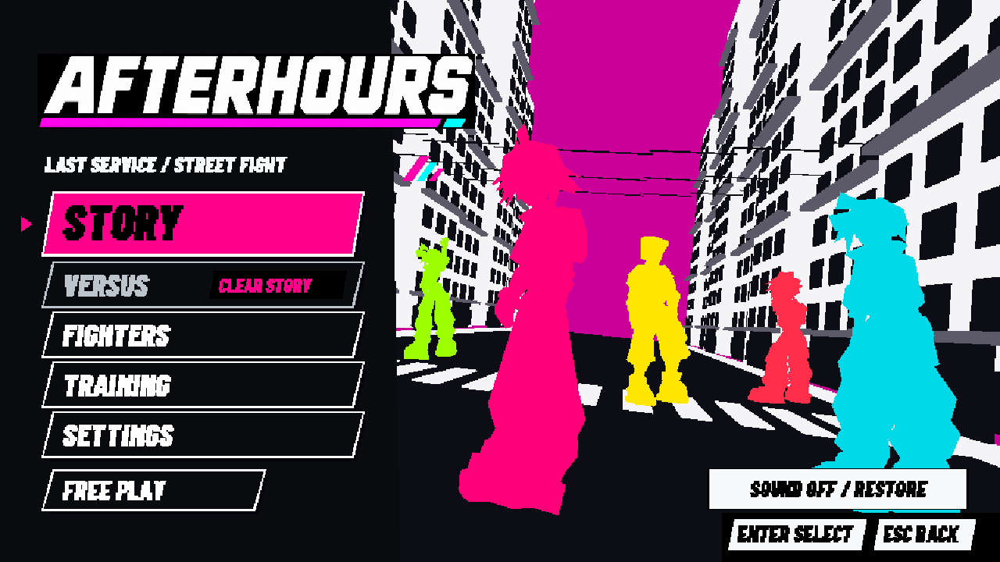
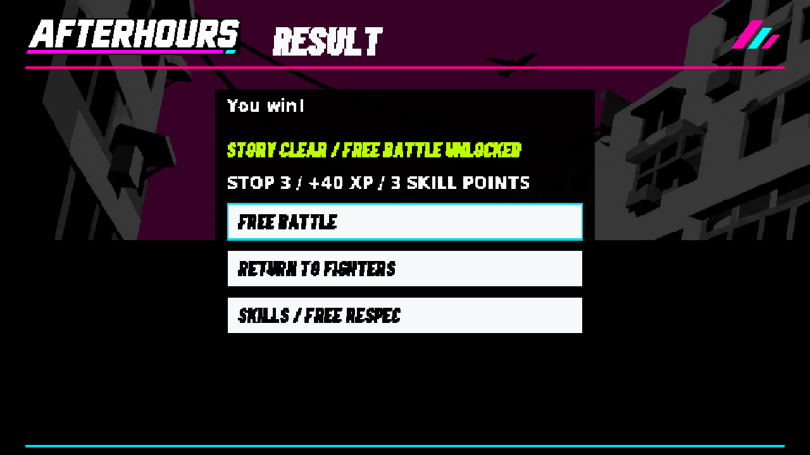
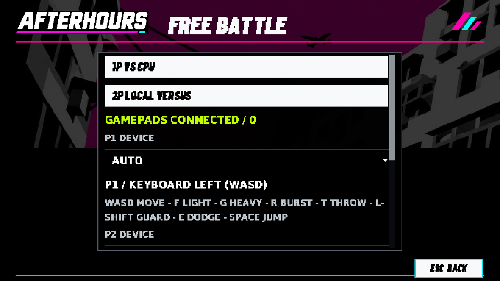
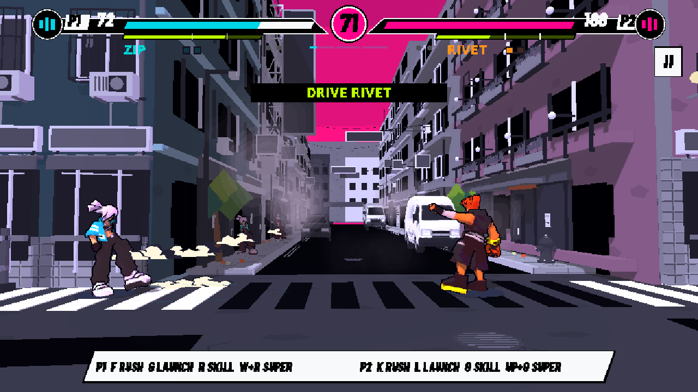
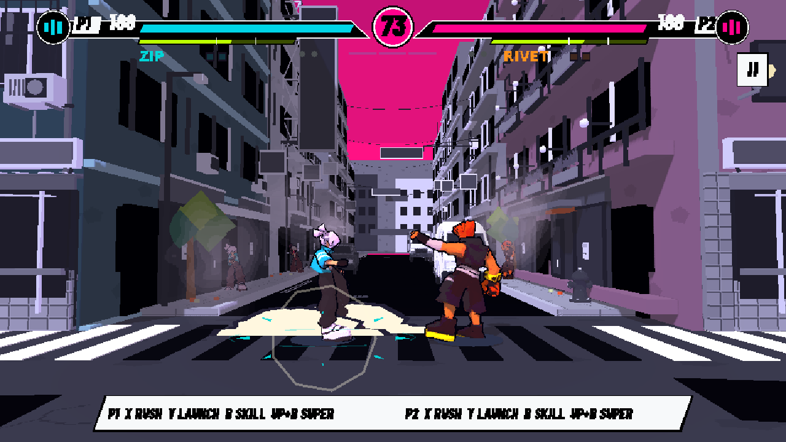
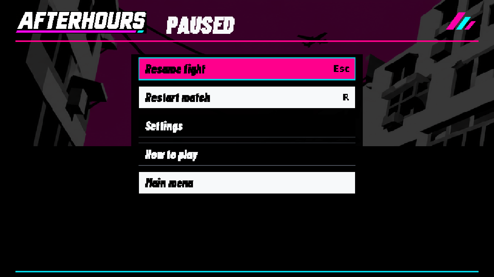

# 故事解鎖／本機雙人／手柄驗證

基線 `codex/combat-escalation-next` 3389fa9；Godot 4.6.3 Linux Compatibility，Xvfb＋Mesa llvmpipe，Dummy audio。**輸入全部是注入的 InputEvent 與注入的手柄清單**，不是實體手柄、真人按鍵、鬼鍵、手感、Mac 或 GPU 驗收。









- `checks.json`：68/68，逐項名稱與結果。
- `logs/verify_local_versus.log`：對應執行 log。唯一 ERROR 是 ALSA 無音效裝置；無 SCRIPT ERROR。
- `logs/` 其餘：改動後在 Codex 分支上的既有回歸 log。reference_ui 37/37、live_combat 45/45、last_service_rules exit 0。combat_input 12/15、double_jump_input 8/11、first_minute 60/63、last_service_native exit 1，與未改動的 3389fa9 同機結果逐行相同，屬既有失敗。
- 先前在 main 738c740 上做過改動前後同機對照，上述各套結果相同（reference_ui 當時 37/37，為舊的 5 選項斷言）；verify_ui_input、verify_jsr_runtime、verify_demo_input 在該基線改動前已逾時或失敗，沒有作為依據，也沒有修。
- `../ui-replica/title.png`、`fighters.png`、`checks.json` 隨 6 選項主選單重新產生；該目錄其餘畫面未更新。

重現：

```
xvfb-run -a godot --rendering-driver opengl3 --path godot --script res://tools/verify_local_versus.gd
```

測試使用獨立的 `user://verify_local_versus/` 存檔與設定，不動真實進度。匯入產生的 .import／.uid 差異未提交。
