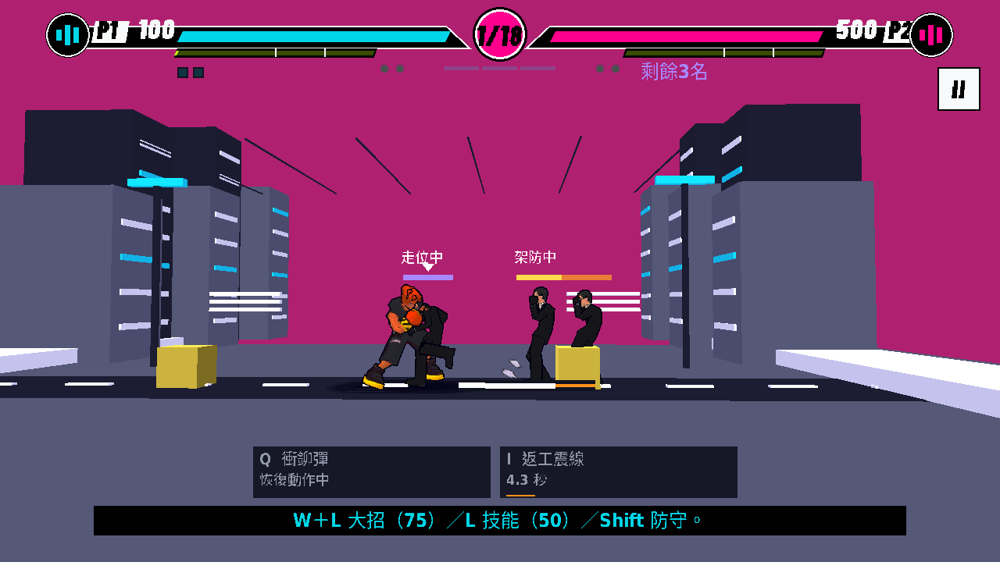
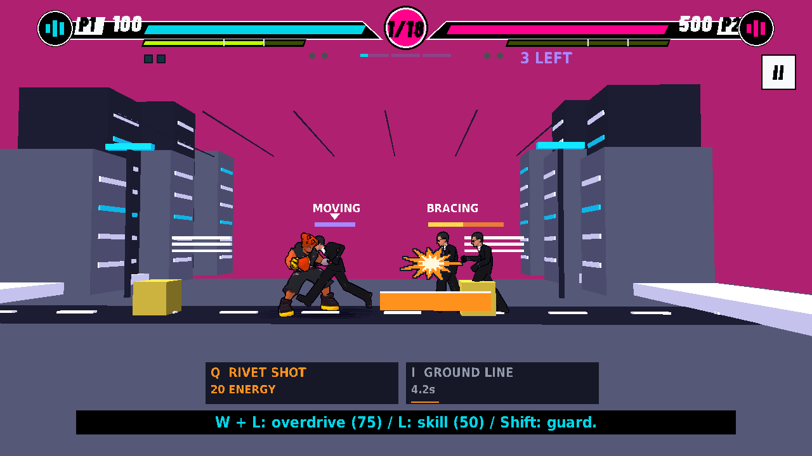

# Ground-warning counterplay evidence — 2026-11-16

[Gameplay rules and interpretation](../../TACTICAL_ENEMY_RESPONSE.zh-TW.md).

- [42 focused rules](rules.json): role-specific step/brace/heavy behavior, actual actor identity, no dodge/jump/invulnerability or auto-parry, sampling/age/ownership/gates, state commitment, no cooldown refund on interruption, hitstop, inward edge route, exhausted guard, duration bound, no direct damage/movement authority, and paid-cast integration.
- [60 checks / 28 paired-replay scenarios](encounters.json): Normal/Hard three role recipes with four RIVET configurations plus two Normal bosses with two configurations. The pilot waits for arrival and uses a wide ground line at close openings for all paired builds. Initial100 HP/60 energy; no runtime resource/position/HP grants. Includes zero casts/zero module contacts and failed Signal-boss runs. Not human balance or full campaign validation.
- [8 new native checks](native.json): real I warning, ordinary enemy movement and guarding, heavy exemption, no auto-parry, paid fee, pause freeze and exit clear. UI account is best18; observation fixture relocates500-HP role actors into a paid warning, temporarily disables attacks to inspect simultaneous cues, then enables AI. It is separate from the unmodified live-AI encounter runs.
- [Regression matrix](regressions.json): original module80, expanded109, first-eight104, readiness53, original encounters15, service46, city86, campaign50, gun21, Chinese21. Suites overlap.
- Native regressions: [modules8](verify_tactical_modules_native.log), [expanded39](verify_expanded_native.log), [readiness14](verify_tactic_readiness_native.log). Current snapshots: [modules](module-native.json), [expanded](expanded-native.json), [readiness](readiness-native.json), [module rules](module-rules.json), [expanded rules](expanded-rules.json), [first-eight rules](first-eight-rules.json), [readiness rules](readiness-rules.json) and [Chinese coverage](chinese.json). Historical artifact folders are restored before commit.
- [22 scripts / seven fatal warning categories](changed-strict.log).

Environment: Godot4.6.3, Linux Compatibility/Mesa llvmpipe,1280×720, Dummy audio. The prior private X display had stopped; native runs use recovered Xvfb on`:100`. Accepted logs have no engine/script errors; V-Sync warnings remain. Not Mac, real controller, human timing, audio listening or hardware FPS evidence.




From repository root, after asset import:

```sh
python tools/verify_tactical_compile.py --output docs/evidence/module-counterplay/changed-strict.log
godot --headless --path godot --script res://tools/verify_enemy_tactic_response.gd
godot --headless --path godot --script res://tools/verify_module_encounters.gd
# Requires an available desktop or X display:
godot --path godot --rendering-method gl_compatibility --audio-driver Dummy --script res://tools/verify_enemy_response_native.gd
```
