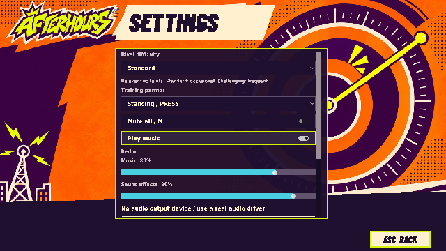
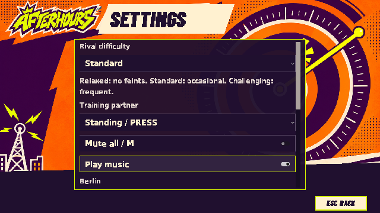
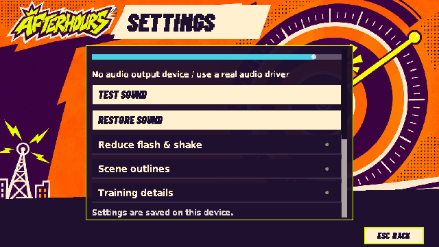
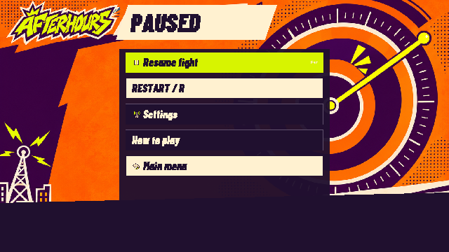
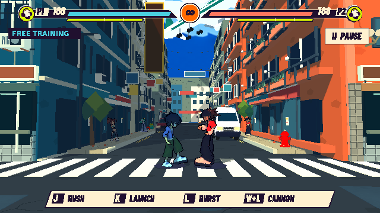
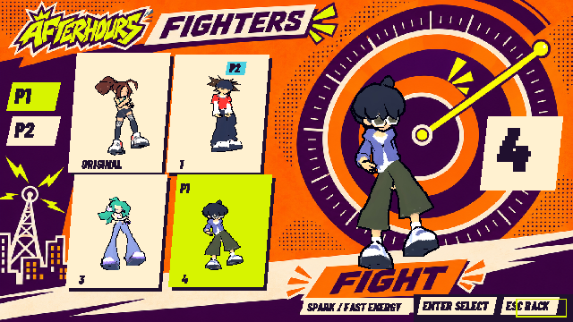
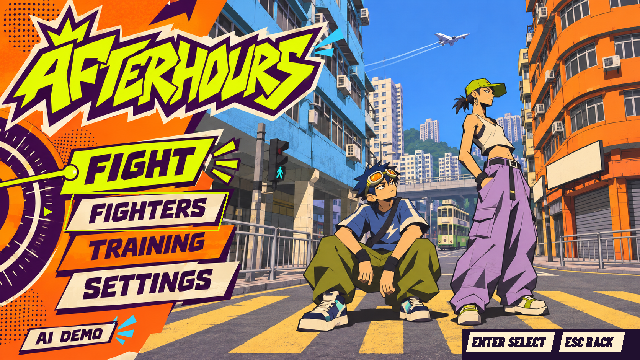

# UI可讀性覆核

Godot4.7.2，原生Compatibility／llvmpipe；640×360共同合成，沒有提高遊戲解析度。

## 設定頁前後

前輪：

本輪：

## 聲音／畫面設定

## 暫停及操作列

## 選角及主選單

[22條呈現檢查](presentation-checks.json) · [37條原生操作檢查](controls/checks.json) · [144條回歸](regressions/summary.json) · [6條PCM檢查](audio-checks.json) · [範圍及限制](../../UI_READABILITY.zh-TW.md)

## 材質錯誤回歸

[修正前12條錯誤](material-before.log)／[修正後6項嚴格檢查，零engine error](material-suite/summary.json)。覆蓋首選0／1／3、24次選角、3次場景生命週期及佇列清空。
