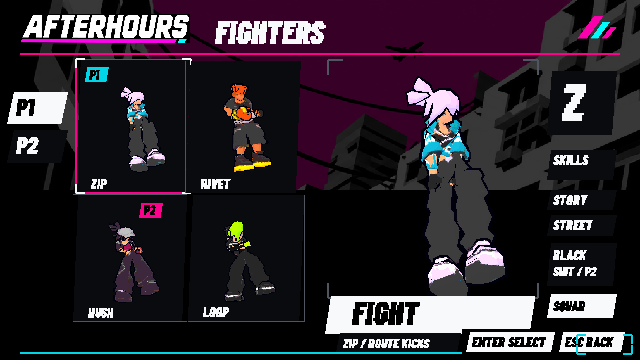
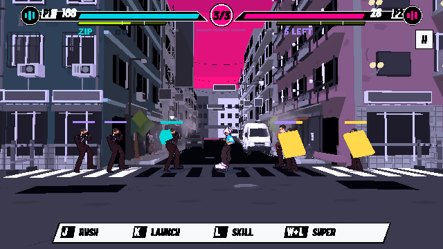
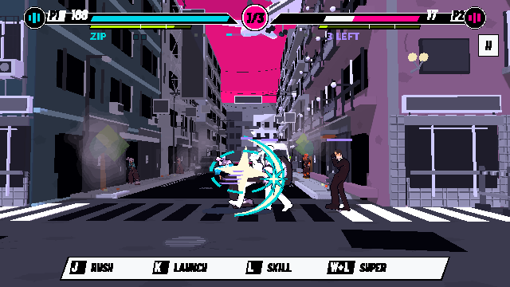

# 故事波次M1：可玩切片與驗證

來源基線main ef3f8d3，任務分支codex/story-waves-m1。這是M1三波預覽，沒有宣稱六關／大型Boss／新核心區段或退出續關存檔已完成。

`accepted/summary.json`為最終通過集合：287項（故事規則37、原生故事17、startup嚴格編譯11、既有反彈65、二段跳62、戰鬥34、UI／音樂37、回合／Demo24），全數通過、對應log無ERROR／SCRIPT ERROR。Native保留VSync不支援警告。

Godot4.7.2.stable.ed1daf0bf Linux Compatibility／llvmpipe／Dummy audio，非Mac／真人／硬件FPS／實聽驗收。原生測試用真pointer進STORY、J造成傷害、↓+K形成真連鎖，另有明示邊界fixture檢查暫停／Enter接波、R重試、結算與模式清理，不能當真人完整通關影片。

純規則測試四英雄明確選Easy，普通rush／朝向移動／重踢／破解盾衛投技，不補血、不注入傷害、不重開，全部清完三波；具體hit／chain／tick在accepted/story-rules.json。這是自動輸入控制器，不是人類難度／完成時間驗收。另2400步重播一致、1200步Story關閉與原Squad基類一致。

連鎖規則驗證真重踢→間接命中、穿越式高速碰撞、同鏈去重、四目標上限、60/40/25/15%衰減、一次+4能量、盾衛正面擋撞體、玩家不受自身撞體傷害、落地屍體不傷人、白閃消退及鏈期限。第三波真6具骨架，兩面盾；獨立投影量測玩家約68內部像素，且六名敵人均在測試viewport安全區。這不是其他長寬比／硬件效能的完整驗證。

初次失敗保留initial-attempts：桌面尚未啟動不能連X11；工具初始化後以共享X11正常渲染。突進fixture原本讓更近的普通兵獲得進攻焦點，修正fixture以測真正被選中的突進者，未放寬遊戲選敵條件。舊round-flow要求至少四次intro，但現行裝備契約故意省略第三局重複intro；未修改基線同樣23/24，測試現要求真equip被觀察、三輪真勝負及下一場完整intro，最終24/24，不改Demo玩法。

其餘資料夾保留中途runner輸出，包含已知舊fixture失敗；判讀最終結果以accepted為準。新原生圖在本資料夾，既有ui-replica圖片、來源.import及匯入生成的無關UID已還原。只推新分支，不改main或公開Web。

重跑：先匯入Godot專案，再用tools/verify_game_polish.py的verify_story_waves（headless）／verify_story_native（native）；嚴格編譯用tools/verify_godot_warnings.py。native需要有效DISPLAY／XAUTHORITY。
