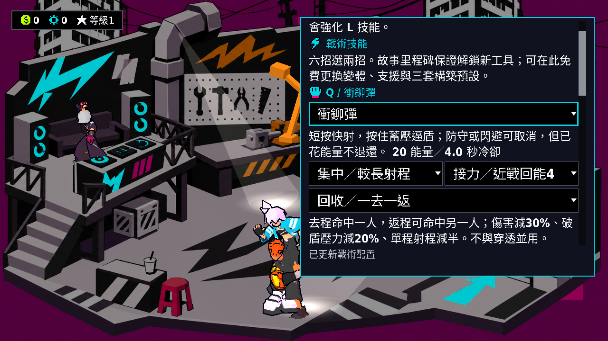
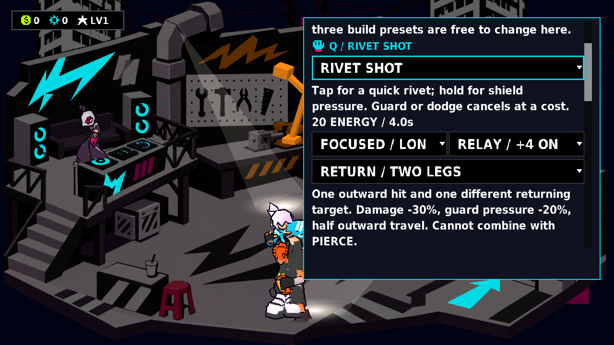
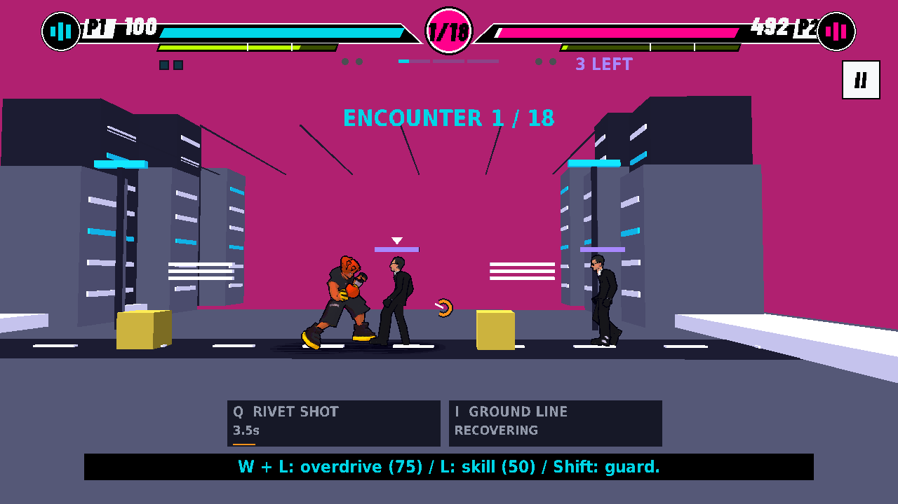
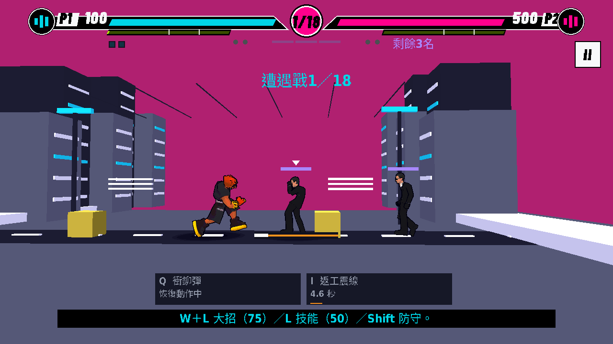
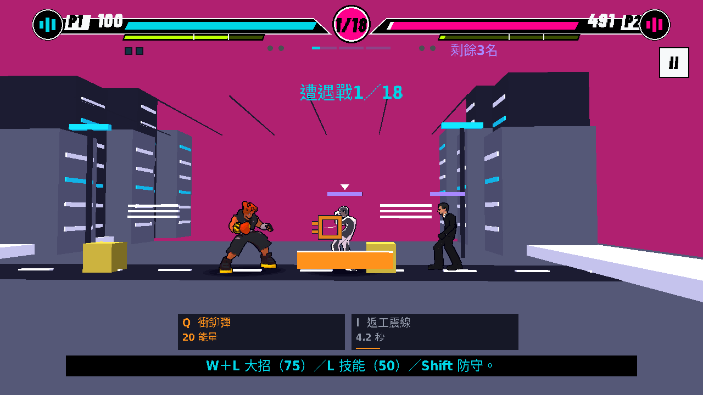

# Second support modules evidence — 2026-11-16

[Behavior, compatibility and limits](../../TACTICAL_MODULES.zh-TW.md).

- [80 rules](rules.json): all24 skills × two module compatibility cases, transactional fitting in either order, combat boundary rejection, real two-leg contact, one contact per body, one melee-refund budget even after consumption, bounded wall reversal, delayed warning/contact/cue, leaving/jumping avoidance, freeze, wide/anchor coverage, malformed current-schema rejection and schema4–6 nested-preset migration/reload. Unit contacts use explicit static-target and resource fixtures; they are not natural encounter balance tests.
- [8 native checks](native.json): actual second-support selectors and keyboard selection, disabled incompatible choices and tooltips, real Q return with one paid fee, actual I warned area then one paid damage event. UI account has best18; combat fixtures have100 energy, static relocated500-HP targets and enemy AI disabled for isolated observation.
- [Regression matrix](regressions.json): expanded109, original104, readiness53, service46, city86, campaign50 and gun21; current [Chinese coverage](chinese.json) retains every catalog Han character.
- Native regressions: [original20](verify_tactical_native.log), [expanded39](verify_expanded_native.log), [readiness14](verify_tactic_readiness_native.log). Current snapshots: [original native](first-eight-native.json), [expanded native](expanded-native.json), [readiness native](readiness-native.json), [expanded rules](expanded-rules.json) and [first-eight rules](first-eight-rules.json). Historical folders are restored.
- [21 scripts / seven fatal warning categories](changed-strict.log). All accepted logs reject engine/script errors; virtual-display V-Sync warnings remain.

Environment: Godot4.6.3, Linux Compatibility/Mesa llvmpipe,1280×720, Dummy audio. Not human ergonomics, natural18-encounter pacing, Mac, real controller, speaker or hardware FPS validation. Raw GLBs/BGM and publicWeb are unchanged.







After importing project assets, from repository root:

```sh
python tools/verify_tactical_compile.py --output docs/evidence/tactical-modules/changed-strict.log
godot --headless --path godot --script res://tools/verify_tactical_modules.gd
# Requires an X display or desktop:
godot --path godot --rendering-method gl_compatibility --audio-driver Dummy --script res://tools/verify_tactical_modules_native.gd
```
