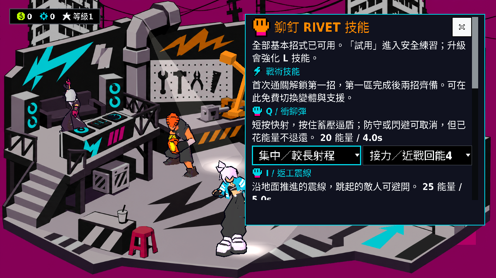
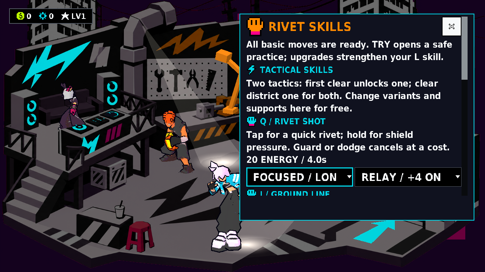
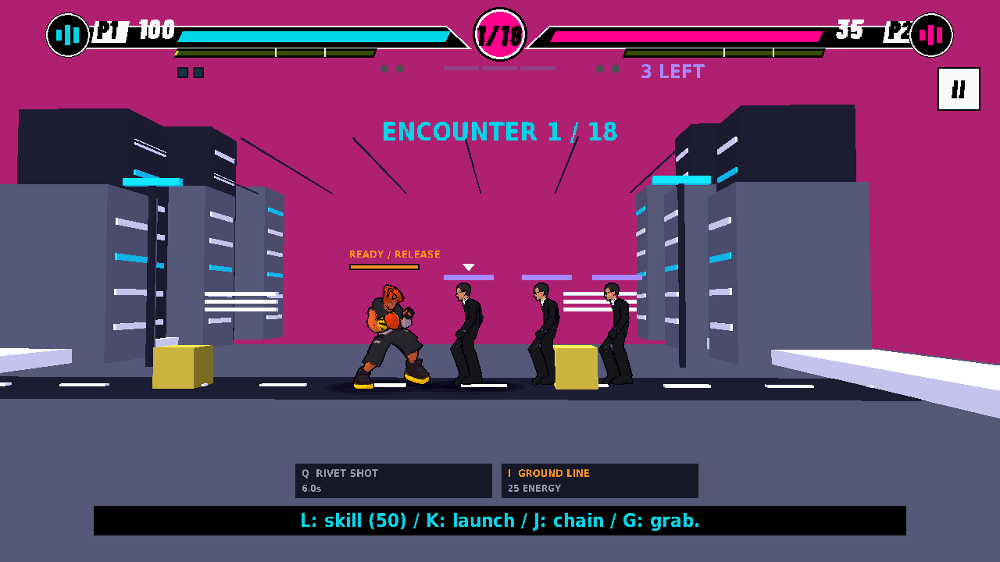
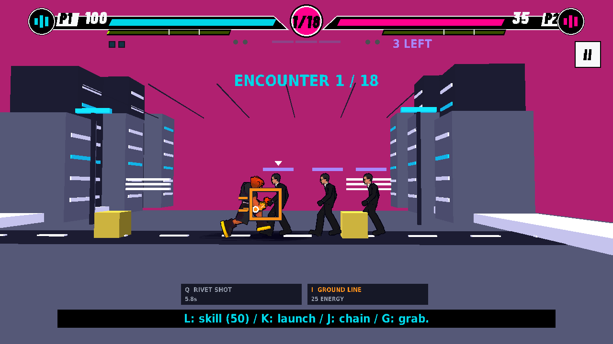
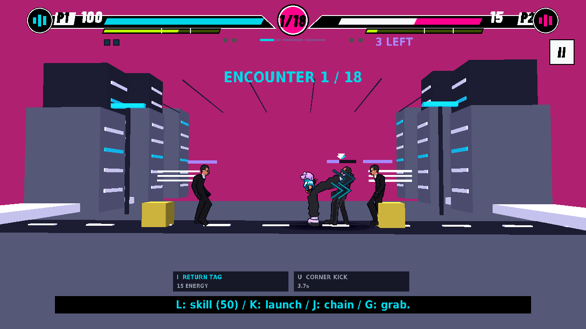
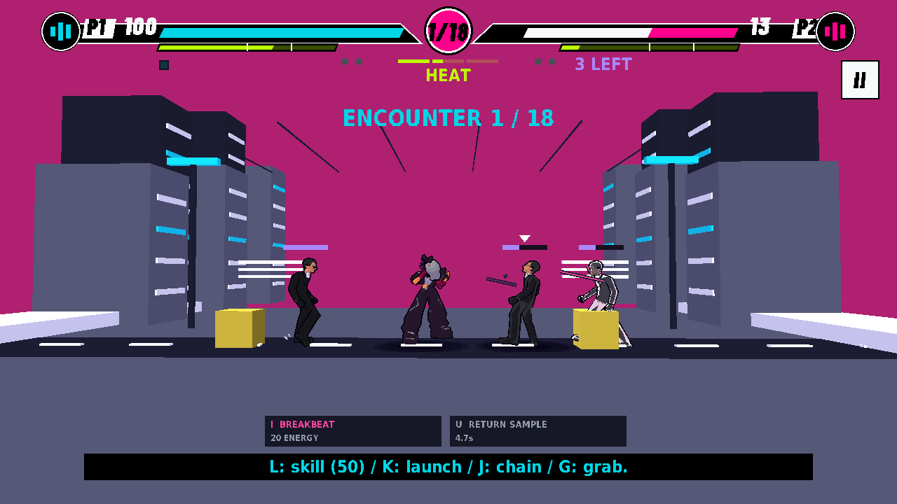
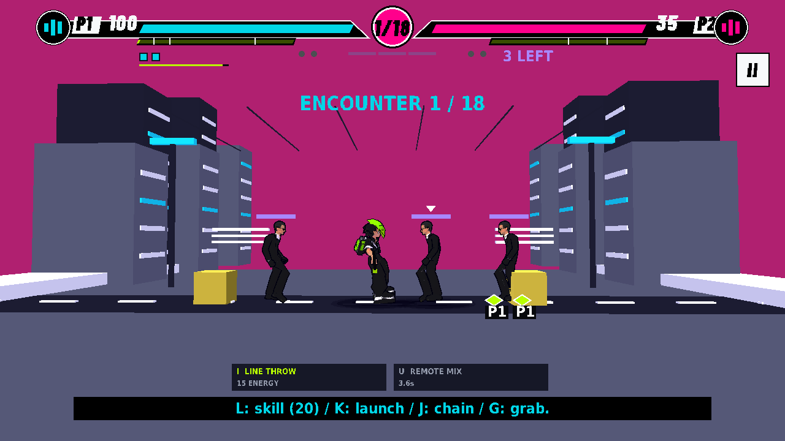

# Tactical skills evidence — 2026-11-16

Implementation and controls: [runtime notes](../../TACTICAL_SKILLS_RUNTIME.zh-TW.md).

- [100 tactical rule checks](checks.json): paid fast/full charge, interruption, suspension, bounded variants/supports, actual gun sample receive/send, no self-refund, normal block and boss armour, original save bytes and schema1–4 reload, deterministic recipes and failed-save rollback.
- [20 native input/UI checks](native.json): actual Q hold/release, native dropdown selection, H safety, reachable help, key swapping, simultaneous intent priority, and eight cast inputs across all four heroes.
- [Regression results](regressions.json): existing service46, city86, campaign50, gun21, Traditional Chinese21; suites overlap. Story-onboarding54 is additionally recorded in [its log](onboarding-regression.log).
- [Changed script compilation](changed-strict.log): 17 scripts with seven fatal warning categories; [existing strict runner](strict/strict.json) covers its original23 scripts. Engine/script errors are failures, not accepted because a runner printed passing booleans.

Screenshots were captured from a real native Godot window using Linux4.6.3 Compatibility/Mesa llvmpipe,1280×720; tests use Dummy audio. Test profile best=3 enables both tactics,100 meter funds charge, and opponents/LOOP nodes/HUSH sample are explicit fixtures. These images do not establish natural chapter pacing, human learning, actual hearing, hardware FPS or Mac performance.









Reproduce from repository root:

```sh
python tools/verify_tactical_compile.py
godot --headless --path godot --script res://tools/verify_tactical_skills.gd
# Use an available real or virtual X display for native runs:
godot --path godot --rendering-method gl_compatibility --audio-driver Dummy --script res://tools/verify_tactical_native.gd
```

Assets must be imported first (`godot --headless --editor --path godot --import`). A virtual display was installed into a temporary directory because this cloud instance did not expose desktop input tools; no system package or project dependency was changed. Benign virtual-display V-Sync warnings are retained in native.log.

Full24 skills, three build presets, a second support slot, real controller ergonomics, human feel and balance remain unverified or unimplemented as explained in the runtime notes. Public Web was not deployed.
