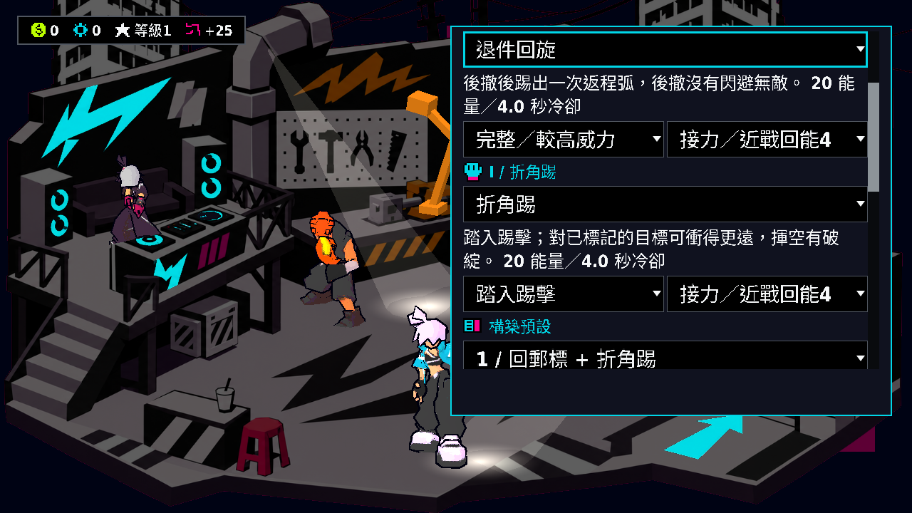
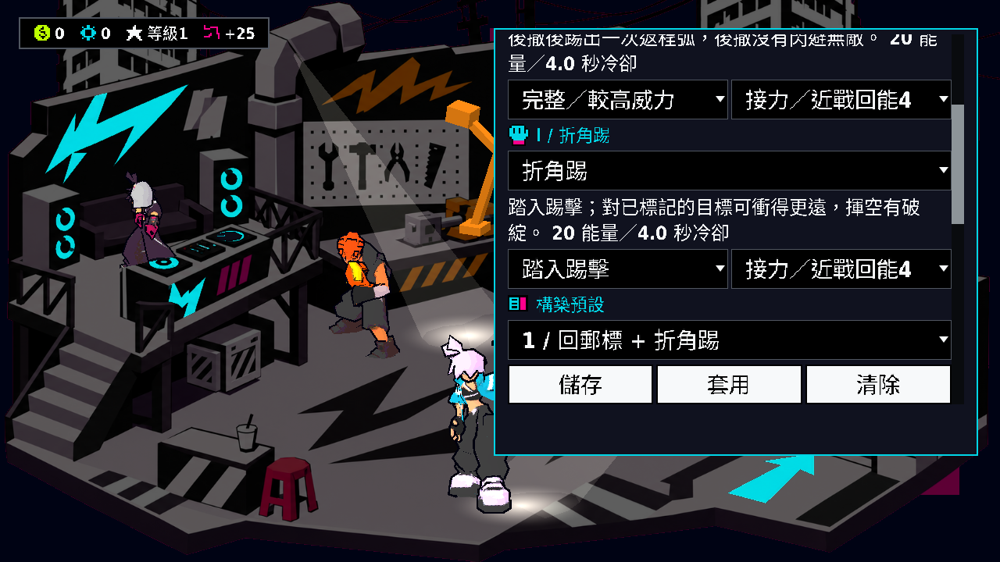
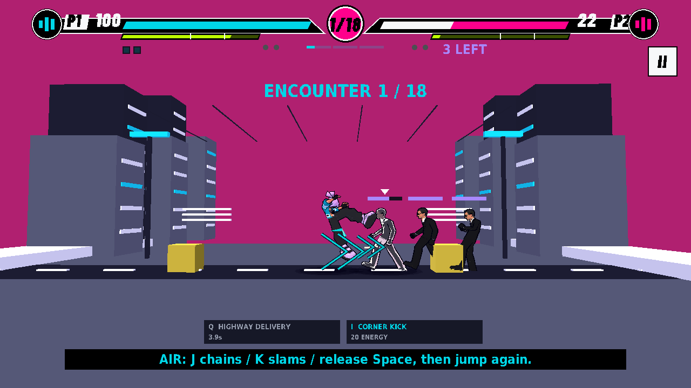
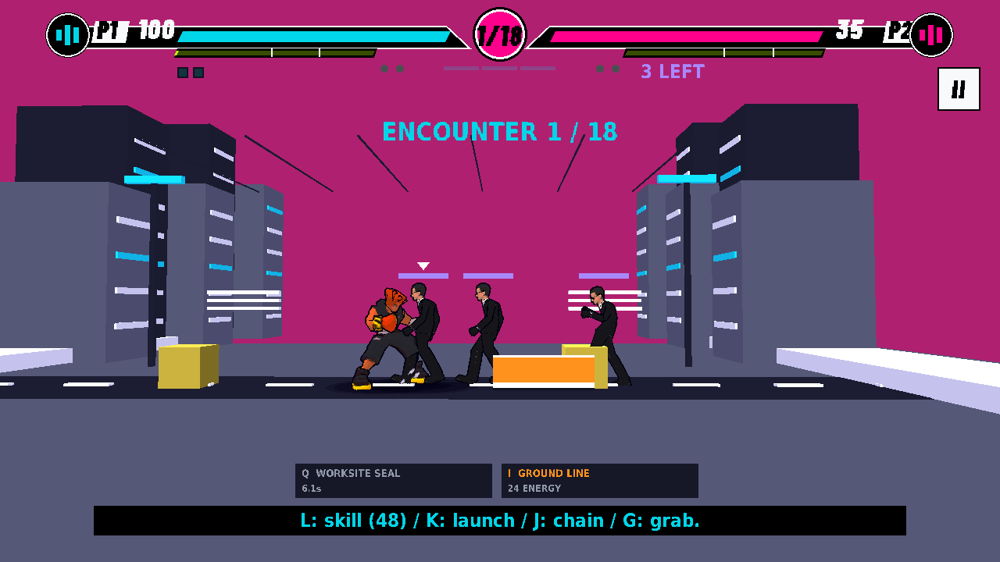
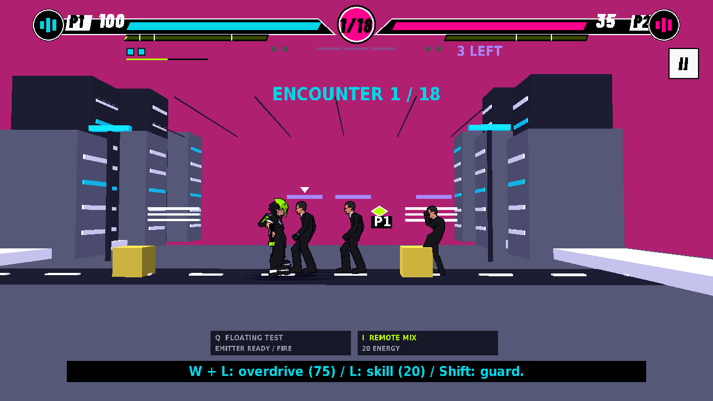

# Expanded tactics evidence — 2026-11-16

Controls, costs, progression and limitations: [runtime notes](../../TACTICAL_EXPANSION.zh-TW.md).

- [Expanded rules](rules.json): 107 checks covering all16 new abilities, jump/preload/node gates, real L-charge conversion with one replacement fee and rejection of interrupted/cooldown/guard/jump refunds, manually confirmed chains, distinct-target delivery, no free continuation on block/whiff, boss-safe pull/suppression, live bullet preservation, bounded shared broadcast contacts, real delayed-area cue, schema3–5 migration, schema4 choice preservation, full-build save/load, atomic failures and reloaded equipment protection.
- [First-eight regression](first-eight.json) 102 checks keep the existing tactical mechanics. New migration coverage adds schema5.
- [Native UI/input](native.json): 39 checks covering the real six-choice picker, actual save/load buttons, each new ability's real story actor and keyboard input, L-to-fan input and replacement fee, and ground seal's detonation through native effects. [20 original native checks](first-eight-native/native.json) retain H safety, RIVET charge, key remapping and the original cast routes.
- [Regression matrix](regressions.json) records service46, city86, campaign50, gun21 and Traditional Chinese21, alongside the new suites. Story-onboarding54 is in [its log](onboarding.log) and [checks](onboarding.json); current [Chinese coverage checks](chinese.json) retain all catalog glyphs. Suites overlap; do not add them into a unique coverage count.
- [20 changed scripts under seven fatal warning categories](changed-strict.log).

Environment: Godot4.6.3, Linux native Compatibility/Mesa llvmpipe,1280×720, Dummy audio. Captures use a test account with best=18,100 energy and explicit prerequisite fixtures (routes only for ZIP two-stop, sample only for HUSH original return, nodes only for LOOP). RIVET vent is reached by actual L input followed by Q during its preload window. These are actual simulation contacts and input routes, but not human learning, natural chapter pacing, speaker listening, real controller ergonomics or hardware FPS certification.








From repository root, after importing Godot assets:

```sh
python tools/verify_tactical_compile.py
godot --headless --path godot --script res://tools/verify_expanded_tactics.gd
godot --headless --path godot --script res://tools/verify_tactical_skills.gd
# Native tests require an available X display or desktop:
godot --path godot --rendering-method gl_compatibility --audio-driver Dummy --script res://tools/verify_expanded_native.gd
```

V-Sync warnings from the virtual display are retained. Engine/script errors fail the accepted run. Original evidence directories from prior tasks are not overwritten by the final evidence set. Public Web is unchanged.
