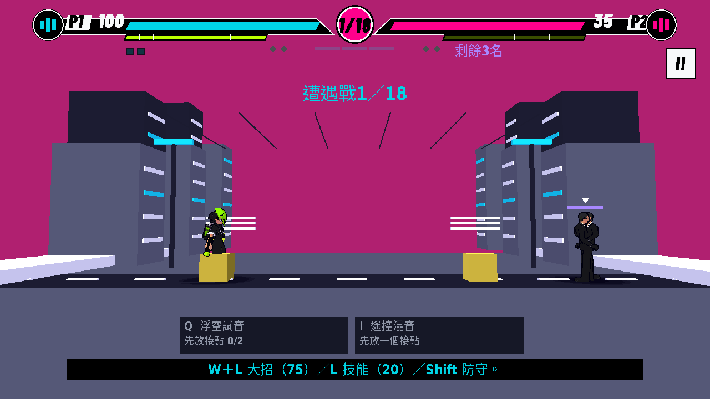
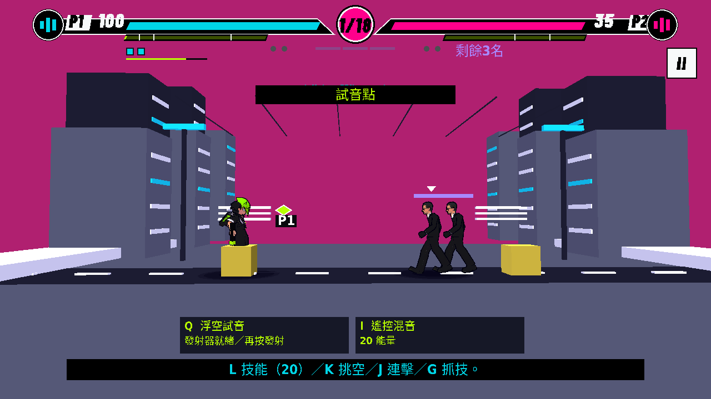
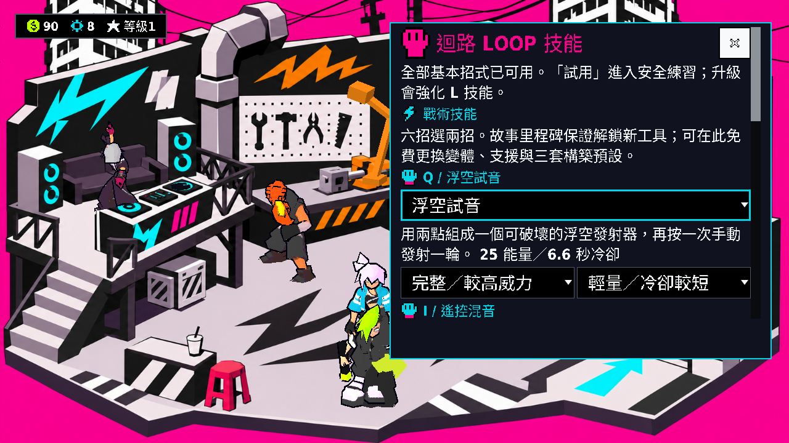
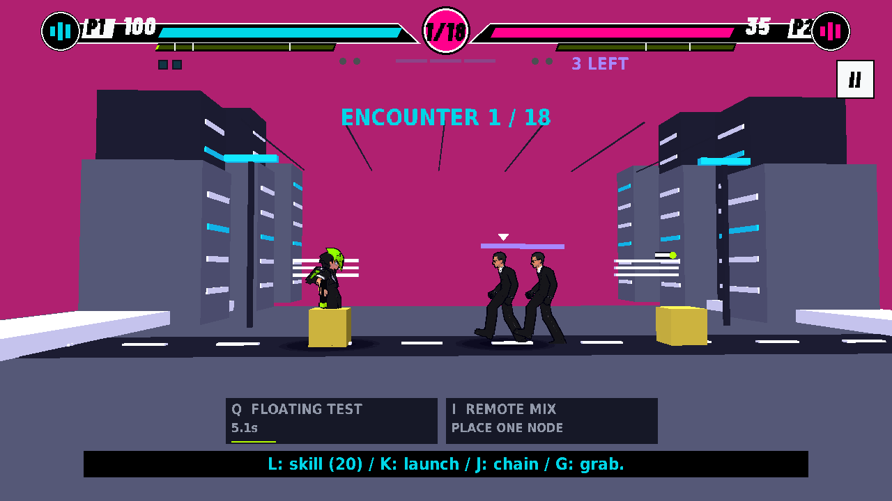

# Tactical usability evidence — 2026-11-16

[Behavior and limits](../../TACTICAL_USABILITY.zh-TW.md).

- [53 readiness checks](readiness.json): prerequisite hints and actual rejects, discounted fees, L-credit conversion, optional charge fee, free sample/emitter/confirmed followups, immediate interruption, all24 supported/anchored cooldown quotes, fixed-tick progress and non-mutating HUD reads.
- [15 encounter checks and six run records](encounters.json): same command policy and Normal live AI, three authored role recipes, two RIVET configurations and deterministic replays. Initial100 HP/60 energy; no per-tick grants or target repositioning. Limited fixtures, idealized defense, not human balance or full chapter pacing.
- [14 native checks](native.json): enlarged English/Chinese names and hints fit, actual modified cooldown label, actual Q rejection, two actual L node placements, paid emitter setup, bright free followup and real Q firing. UI account fixture has best18 and explicit crafting currency; combat starts with100 energy and arrival delay plus moved targets for isolated inspection, not a natural encounter comparison.
- [Regression matrix](regressions.json), [20 scripts under seven fatal warning categories](changed-strict.log). Suites overlap; do not sum them as unique coverage.
- Original native regressions: [first-eight log](verify_tactical_native.log) and [24-ability log](verify_expanded_native.log). Current snapshots: [first-eight native](first-eight-native.json), [expanded native](expanded-native.json), [first-eight rules](first-eight-rules.json), [expanded rules](expanded-rules.json) and [Chinese glyph coverage](chinese.json). Historical evidence stays unchanged.

Environment: Godot4.6.3, Linux Compatibility, Mesa llvmpipe,1280×720, Dummy audio. V-Sync warnings from Xvfb remain; engine/script errors fail accepted runs. No Mac, real controller, human ergonomics, speaker listening or hardware FPS claim.






From the repository root, after asset import:

```sh
python tools/verify_tactical_compile.py --output docs/evidence/tactics-usability/changed-strict.log
godot --headless --path godot --script res://tools/verify_tactic_readiness.gd
godot --headless --path godot --script res://tools/verify_tactic_encounters.gd
# Requires an available X display or desktop:
godot --path godot --rendering-method gl_compatibility --audio-driver Dummy --script res://tools/verify_tactic_readiness_native.gd
```
