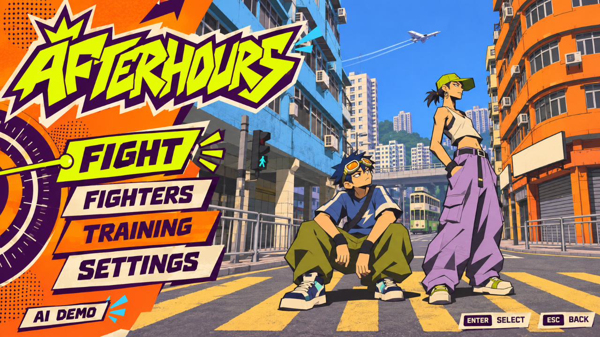
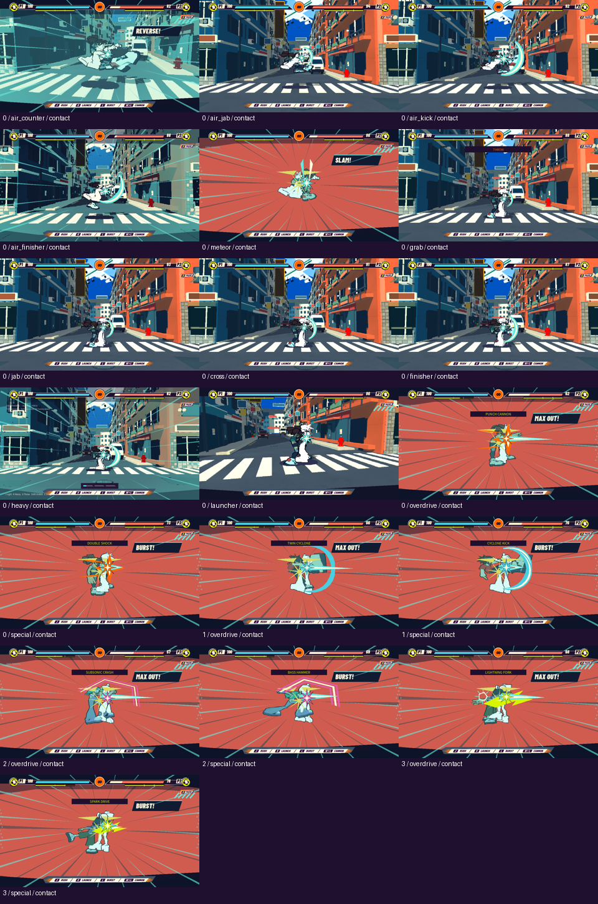

# Reference UI / music / VFX evidence

Godot4.6.3 Compatibility, Mesa llvmpipe, Dummy audio. Native input is injected. No human feel/listening/target-GPU claim. Public Web unchanged.

## Screens

- [Four-card Fighters](fighters.png), alternate heroes [Original](fighter-card-0.png) / [1](fighter-card-1.png) / [3](fighter-card-2.png)
- [Live HUD](hud.png), [Settings](settings.png), [lower options](settings-bottom.png), [Pause](pause.png)
- [8-second uninterrupted Demo](demo.mp4), [capture facts](demo-capture.json):120frames/15fps/480fixed-wall steps, no soundtrack. This is not a frame-rate benchmark.

## Verification

- [37/37 native checks](checks.json), [final verbose log](native-final.log):5 named actions,3sizes, actual arrow/Enter, pointer P1/P2 cards, all4profile selections, settings popup/Esc/scroll, slider, pause/resume/zero-volume advancing music, reversible crossfade, bounded decks, F2, HUD Pause, staged finite geometry, no raster combat stamps and exit cleanup. Final stream-caching/mixer-flush run has no ObjectDB leak warning.
- [19/19 actual attack routes](effect-review.json):all13 moves plus3additional character special pairs. Each has swing/contact/release shots; legacy heavy runs in its actual lab mode because arcade K maps to launcher.7defense/movement pictures are isolated rendering diagnostics, not gameplay contacts.
- [Headless combat](gameplay-headless/summary.json):144/144, combat34 / air54 / Rush21 / cannon10 / forgiving-defense25.
- [Native rhythm/red-stage](gameplay-native/summary.json):47/47 (29/18).
- [Scene/audio/VFX](scene-audio-final/summary.json):33/33. The old standalone test still expected12 parry energy; updated to the already-existing18 reward without changing gameplay. Failed32/33 remains in scene-audio.
- [40 scripts load](compile.log), [static audit](premium-audit.json)0errors/warnings. The audit is Web-oriented and not native accessibility evidence.
- [Title reference comparison](title-comparison.json):approximately1.14/255 mean absolute RGB difference against the bilinear-scaled source, caused by GPU sampling. This is one default title state, not a blanket100%pixel claim for dynamic screens.
- [Original asset hashes](source-integrity.json):every existing GLB/image/audio/bin remains unchanged. New art/font assets are separately admitted.

The first keyboard Enter path fell through to default Fight; focused-action dispatch is fixed. First manual portrait masks produced paper scraps; archived in references, replaced by clean generated UI portraits. A streaming teardown warning was fixed by retaining each song's dedicated stream. Relevant earlier diagnostics remain in first-pass, not concealed.

## Complete attack review

[All swing frames](review-swing.png) · [All release frames](review-release.png) · [Defense render samples](review-defense.png)

The active renderer now uses authored six-cel vectors and consistent signature colors. Old generated combat atlases are retained as source history but never drawn. Extra circles and bone-stick ghosts are removed; ground cracks require real landing/ground-bounce events. Attack art never causes additional damage.

`effects/` contains all57actual attack-stage screenshots plus7diagnostic samples. They were visually inspected through the three complete sheets and defense sheet. The original effects capture preceded the stream teardown fix, so its old exit warning is preserved in effects.log; final native-final.log/demo.log are the corrected runtime evidence.
