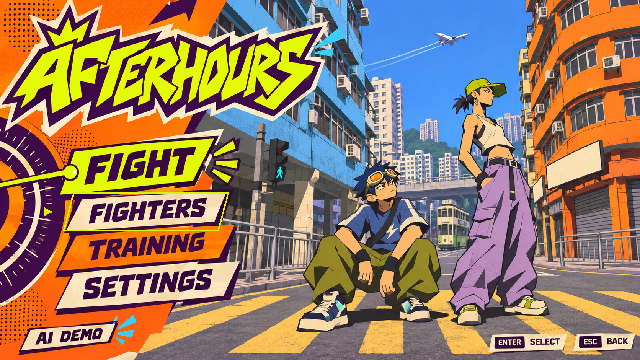
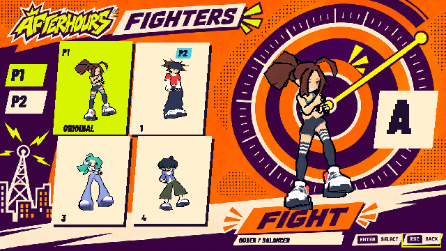
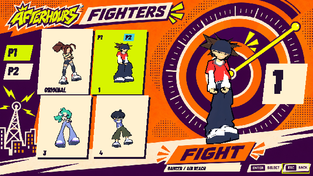
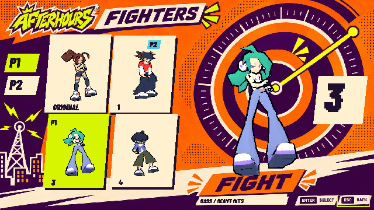
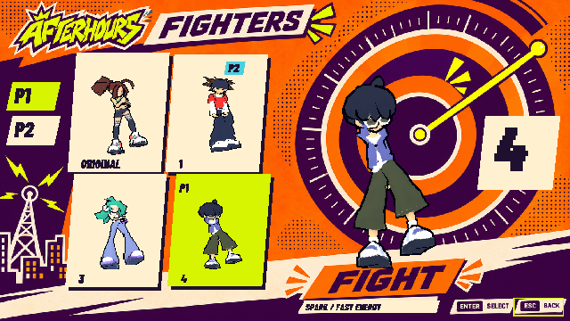
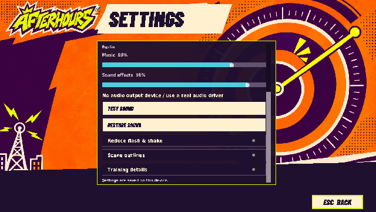
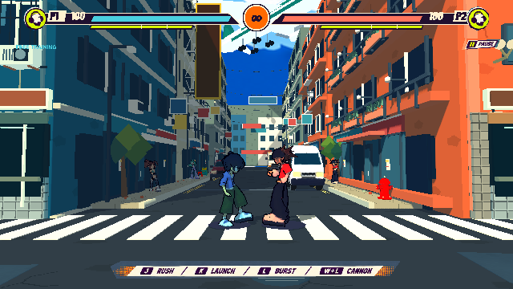

# 本輪實機畫面

Godot4.6.3 native Compatibility／llvmpipe。640×360整個畫面合成；固定步長擷取，不是實測FPS或人類操作。

## title

## roster0

## roster1

## roster2

## roster3

## settings-sound

## street

## 驗證

[呈現檢查](presentation-checks.json) · [音訊PCM](audio-checks.json) · [37條操作檢查](controls/checks.json) · [戰鬥回歸](regressions/summary.json) · [招式路由](effect-review.json)

## 19條攻擊路由

接觸／釋放來自實際合法命中事件。

- 0-air_counter：[接觸](effects/0-air_counter-contact.png)／[釋放](effects/0-air_counter-release.png)
- 0-air_jab：[接觸](effects/0-air_jab-contact.png)／[釋放](effects/0-air_jab-release.png)
- 0-air_kick：[接觸](effects/0-air_kick-contact.png)／[釋放](effects/0-air_kick-release.png)
- 0-air_finisher：[接觸](effects/0-air_finisher-contact.png)／[釋放](effects/0-air_finisher-release.png)
- 0-meteor：[接觸](effects/0-meteor-contact.png)／[釋放](effects/0-meteor-release.png)
- 0-grab：[接觸](effects/0-grab-contact.png)／[釋放](effects/0-grab-release.png)
- 0-jab：[接觸](effects/0-jab-contact.png)／[釋放](effects/0-jab-release.png)
- 0-cross：[接觸](effects/0-cross-contact.png)／[釋放](effects/0-cross-release.png)
- 0-finisher：[接觸](effects/0-finisher-contact.png)／[釋放](effects/0-finisher-release.png)
- 0-heavy：[接觸](effects/0-heavy-contact.png)／[釋放](effects/0-heavy-release.png)
- 0-launcher：[接觸](effects/0-launcher-contact.png)／[釋放](effects/0-launcher-release.png)
- 0-overdrive：[接觸](effects/0-overdrive-contact.png)／[釋放](effects/0-overdrive-release.png)
- 0-special：[接觸](effects/0-special-contact.png)／[釋放](effects/0-special-release.png)
- 1-overdrive：[接觸](effects/1-overdrive-contact.png)／[釋放](effects/1-overdrive-release.png)
- 1-special：[接觸](effects/1-special-contact.png)／[釋放](effects/1-special-release.png)
- 2-overdrive：[接觸](effects/2-overdrive-contact.png)／[釋放](effects/2-overdrive-release.png)
- 2-special：[接觸](effects/2-special-contact.png)／[釋放](effects/2-special-release.png)
- 3-overdrive：[接觸](effects/3-overdrive-contact.png)／[釋放](effects/3-overdrive-release.png)
- 3-special：[接觸](effects/3-special-contact.png)／[釋放](effects/3-special-release.png)
