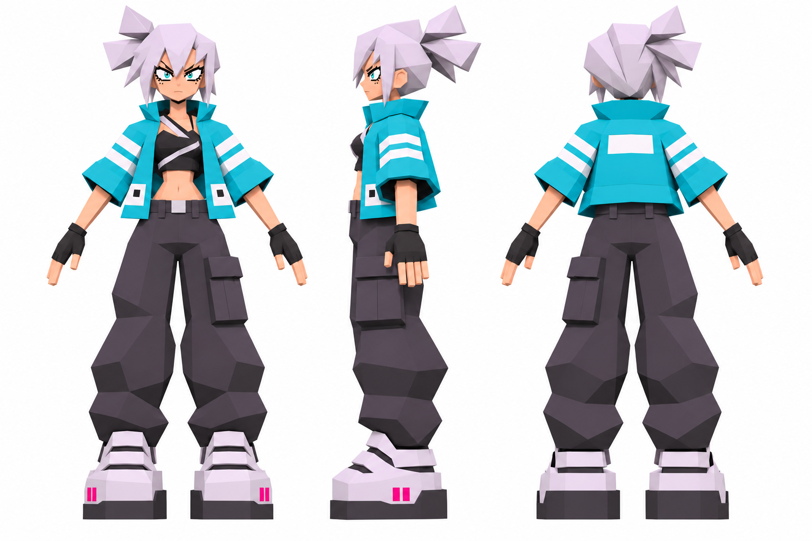
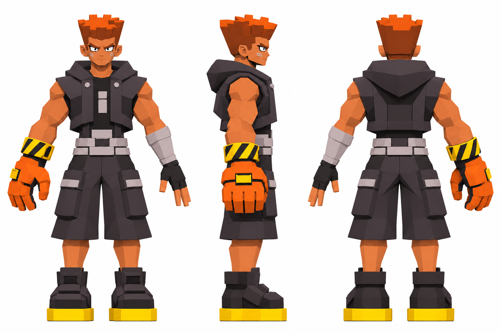
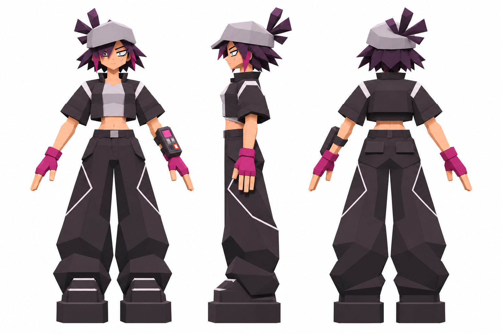
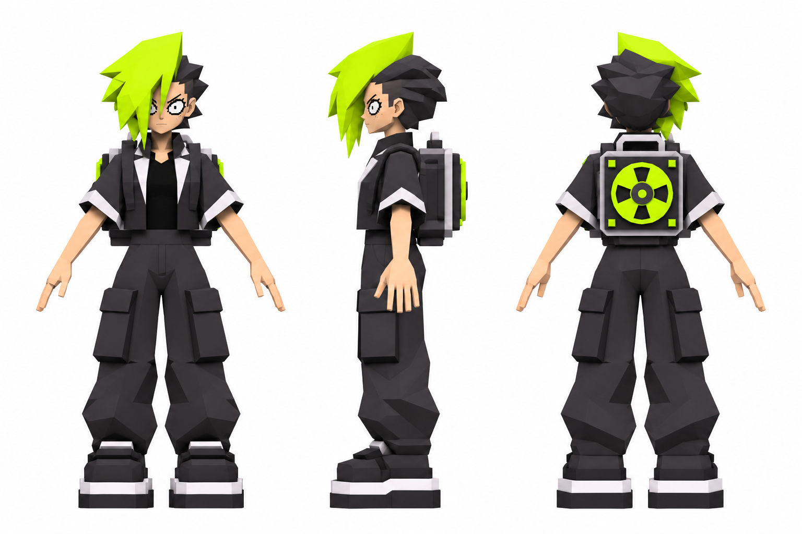
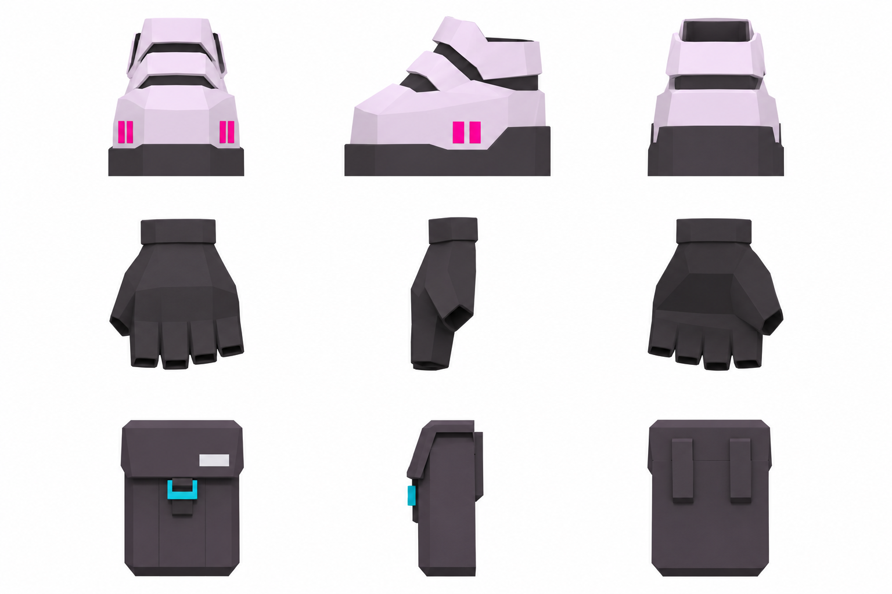
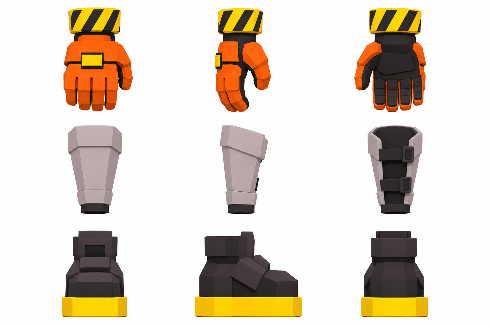
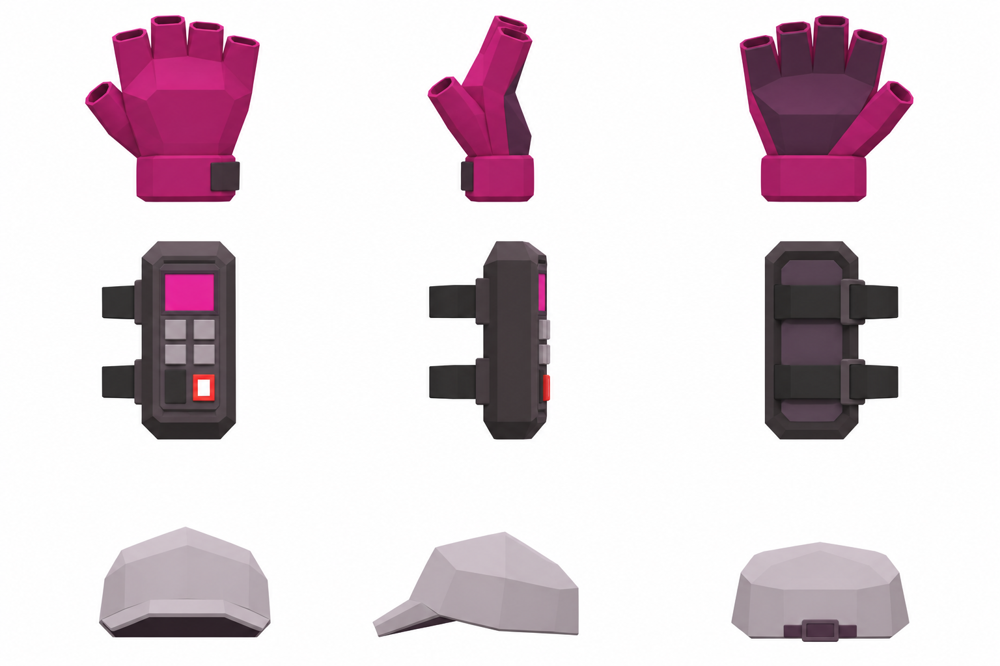
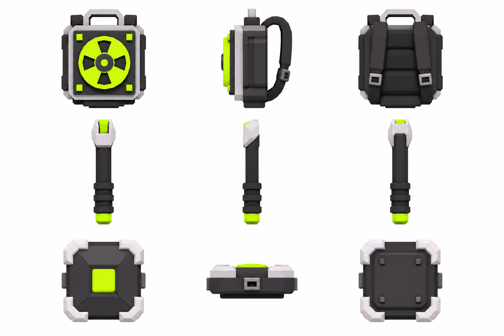
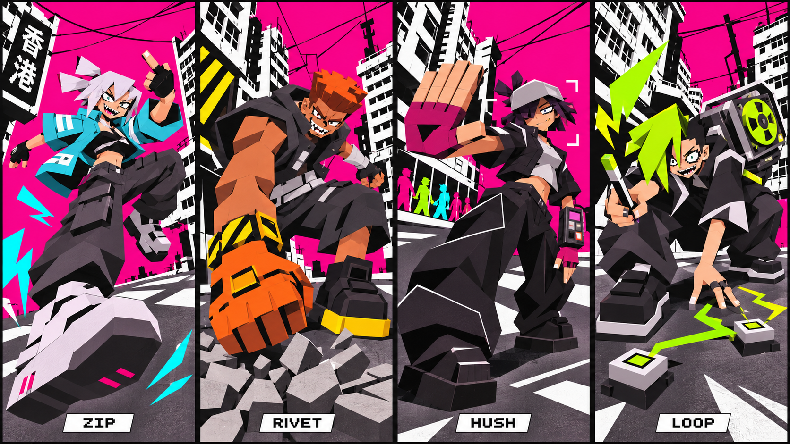

# LAST SERVICE：四角色圖片與來源

2026-11-10。完整人設、技能提案、遊戲現況界線與建模待辦見 [角色設計紀錄](../../docs/LAST_SERVICE_CHARACTERS.zh-TW.md)。[manifest.json](manifest.json) 保存每件檔案的原名、狀態、尺寸及 SHA-256。

## 最新人物三視圖

純白背景、無文字；每張由左至右正面／側面／背面。為生成式建模參考，仍需人工校正跨視角細節。

### ZIP 疾扣

### RIVET 鉚釘

### HUSH 靜噪

### LOOP 迴路

## 最新武器／配件三視圖

每排一件裝備，由左至右為外側／側面／內側；鞋為鞋頭／外側／鞋跟，地面節點為頂面／側面／底面。各排在 sheet 中的展示大小不表示不同裝備的真實相對尺度。

### ZIP：強化戰鞋／露指手套／配送袋

### RIVET：右巨型拳套／左護臂／工作靴

### HUSH：護手／錄音裝置／灰帽

### LOOP：線盤背包／訊號短棍／地面節點

## 動作與表情概念

動作圖保留誇張透視、表情與鏡頭，不能拿透視比例直接作模型量測。

## 歷史稿

以下已被純白底／修訂版取代，僅供追溯：

- [ZIP 灰底標籤版](archive/zip-gray-labeled.png)
- [RIVET 灰底標籤版](archive/rivet-gray-labeled.png)
- [HUSH 灰底標籤版](archive/hush-gray-labeled.png)
- [LOOP 灰底標籤版](archive/loop-gray-labeled.png)
- [HUSH 裝備早稿](archive/hush-equipment-first.png)：拇指開口與帽上混入髮束已於最新版修正。

## 原始影片參考

六件上傳 MP4 原樣保存在 sources/，逐件名稱與雜湊見 manifest。僅作風格研究，未納入遊戲 runtime；使用者提供參考不等於影片散布授權或遊戲素材授權。四張聊天附圖的原始 JPG 未取得，未把 Windows Drive 路徑當成已保存的檔案。
