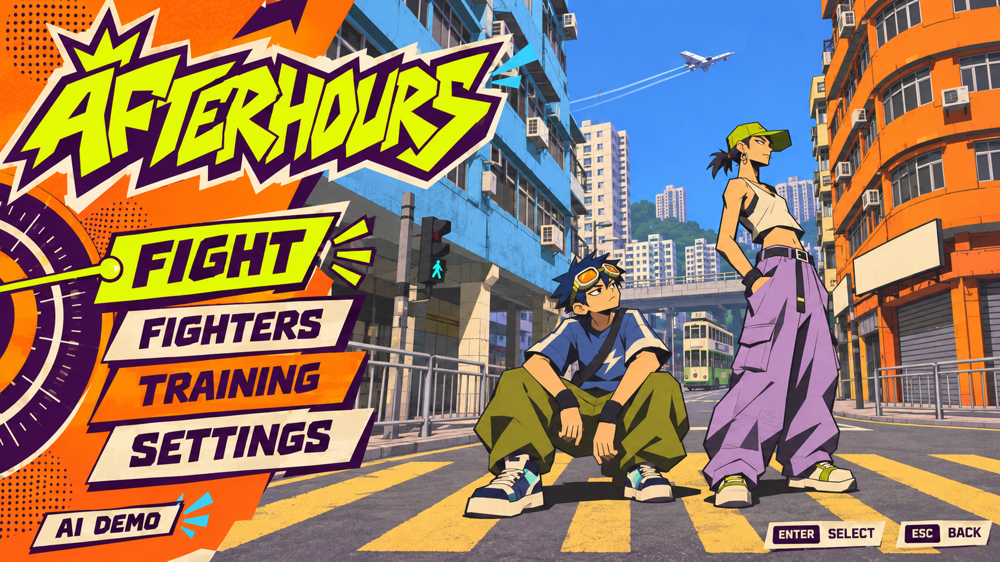
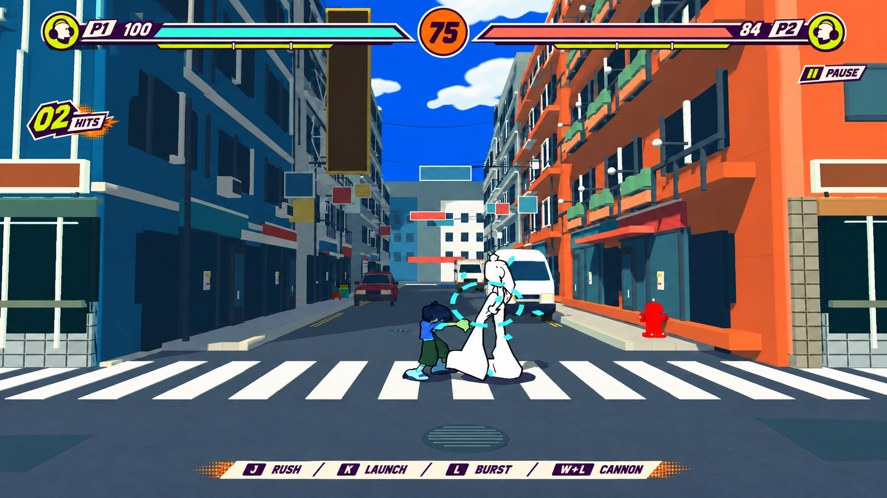
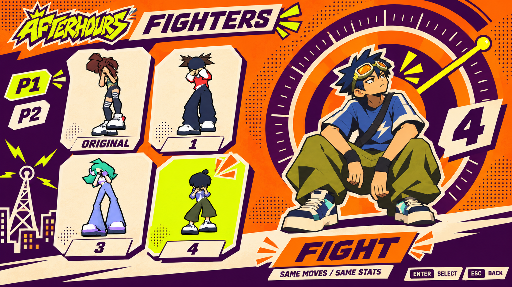

# AFTERHOURS — JSR UI study / v001

主線：**2000 年 Jet Set Radio 的街頭電台與印刷貼紙語言，轉成香港近身街鬥 UI**。

本目錄包含原創生成圖、透明 PNG、切片座標及完整提示詞。圖片是視覺方案，未替換遊戲現有 UI。原版 SEGA 截圖／手冊只供研究，未混進素材包。

- [詳細研究與接入規格](../../docs/JSR_UI_ART_DIRECTION.zh-TW.md)
- [下載素材包](afterhours-jsr-ui-v001.zip)
- [來源](sources.json)／[生成紀錄](generation-manifest.json)／[提案 Tokens](proposal-tokens.json)／[圖集切片](atlas-regions.json)

## 主選單方向

## 建議 HUD：精簡版

## 四角色選擇

卡片參照本作實際模型，右側大幅插畫是概念詮釋，不是新模型／正式角色設定。

## 透明素材

| PNG | 內容 |
|---|---|
| [Logo](assets/afterhours-logo.png) | 2146×733，透明底與留白 |
| [框架圖集](assets/ui-frames.png) | 1536×1024，8 個獨立框架；能量裝飾格線不代表實際 50／75 門檻 |
| [圖示圖集](assets/action-icons.png) | 1261×1247，4×4 共 16 圖示，座標按實際尺寸計算 |

PNG 含真 alpha，部分完全透明像素仍儲存有色 RGB，請用支援透明合成的檢視器。Godot 實際合成：

- [框架與透明內孔](../../docs/evidence/ui-jsr/ui-frames-alpha-preview.png)
- [16 圖示](../../docs/evidence/ui-jsr/action-icons-alpha-preview.png)
- [Logo](../../docs/evidence/ui-jsr/afterhours-logo-alpha-preview.png)

文字、血量／能量填色、時間、連段數、焦點與點按行為應由遊戲即時產生，不從概念畫面裁成整張可點按背景。按鈕高度／斜邊與小尺寸圖示仍需正式元件接入時檢視。

## 可重現檢查

`python tools/inspect_jsr_ui_assets.py`：45/45，PNG 解碼／alpha／留白／區域／透明中心。

`godot --path godot --script res://tools/preview_jsr_ui_assets.gd`：原生合成預覽，需要可用的顯示環境。另有 `capture_ui_roster_reference.gd` 擷取既有四個模型供角色稿參考。

本輪是設計與素材交付，不是遊戲整體無障礙／互動或目標 GPU 驗收。explorations 中保留早期大 HUD、未留白 Logo 與初版框架，主要 ZIP 不包含這些早稿。
